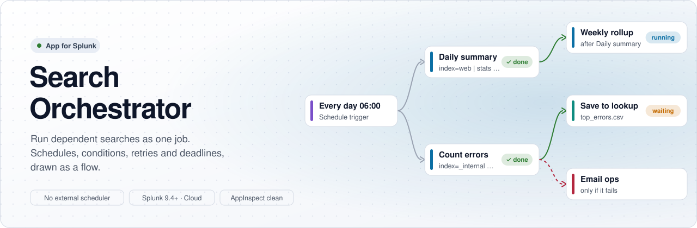
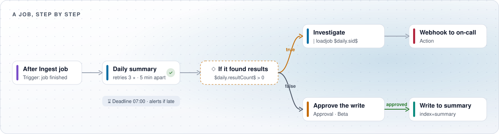

<p align="center">
  <picture>
    <source media="(prefers-color-scheme: dark)" srcset="docs/images/banner-dark.svg">
    
  </picture>
</p>

<p align="center">
  <a href="https://github.com/lyderhansen/search_orchestrator/releases/latest"></a>
  
  
  
  
</p>

<p align="center">
  <a href="#try-it-in-5-minutes"><b>Try it</b></a> ·
  <a href="docs/user-guide.md"><b>User guide</b></a> ·
  <a href="docs/admin-guide.md"><b>Admin guide</b></a> ·
  <a href="CHANGELOG.md"><b>Changelog</b></a> ·
  <a href="https://github.com/lyderhansen/search_orchestrator/issues"><b>Report a problem</b></a>
</p>

---

**Your weekly rollup ran before the daily summary finished. Again.** Splunk schedules every saved search on its own, so searches that depend on each other drift apart, fail on their own and leave gaps nobody notices.

**Search Orchestrator** runs them as one **job**: a flow of search steps that start when the steps before them are done, with conditions, retries, deadlines, approvals and notifications. It runs inside Splunk, with no external scheduler, and every run can be followed, compared and re-run from the step that failed.

<p align="center">
  <picture>
    <source media="(prefers-color-scheme: dark)" srcset="docs/images/job-dark.svg">
    
  </picture>
</p>

## What it does

<table>
  <tr>
    <td width="33%" valign="top">
      <picture><source media="(prefers-color-scheme: dark)" srcset="docs/images/icons/build-dark.svg"></picture>
      <h3>Build</h3>
      Draw jobs on a canvas or list them top to bottom. Start from <b>18 example jobs</b> that use only data every Splunk has. Preview each step before you save.
    </td>
    <td width="33%" valign="top">
      <picture><source media="(prefers-color-scheme: dark)" srcset="docs/images/icons/trigger-dark.svg"></picture>
      <h3>Trigger</h3>
      On a schedule, by hand, from SPL with <code>| orchestrate start</code>, from an alert, over REST, or when another job finishes. Backfill any date range.
    </td>
    <td width="33%" valign="top">
      <picture><source media="(prefers-color-scheme: dark)" srcset="docs/images/icons/branch-dark.svg"></picture>
      <h3>Branch</h3>
      Steps wait for their inputs. Branch on success, failure or a condition such as <code>$daily.resultCount$ &gt; 0</code>, and read earlier steps' results with <code>| loadjob</code>.
    </td>
  </tr>
  <tr>
    <td valign="top">
      <picture><source media="(prefers-color-scheme: dark)" srcset="docs/images/icons/recover-dark.svg"></picture>
      <h3>Recover</h3>
      Retries, delays and deadlines with alerts. Later runs wait for a failed one to be fixed, so a rollup never skips a day. Re-run from any step.
    </td>
    <td valign="top">
      <picture><source media="(prefers-color-scheme: dark)" srcset="docs/images/icons/act-dark.svg"></picture>
      <h3>Act</h3>
      Email, webhook, Slack, Teams, PagerDuty, ServiceNow, any alert action, or write to an index or a lookup. Optional approval steps.
    </td>
    <td valign="top">
      <picture><source media="(prefers-color-scheme: dark)" srcset="docs/images/icons/follow-dark.svg"></picture>
      <h3>Follow</h3>
      Live run graphs, a calendar, run comparison, dependencies between jobs, an audit index, and a Troubleshooting page that explains errors in plain words.
    </td>
  </tr>
</table>

## Try it in 5 minutes

1. **Download** `search_orchestrator-<version>.tgz` from the [latest release](https://github.com/lyderhansen/search_orchestrator/releases/latest).
2. **Install** it in Splunk: **Apps → Manage Apps → Install app from file**, and restart if asked.
3. **Open Search Orchestrator → Jobs → Browse examples**, add one and press **Run now**.

Roles, the audit index and settings are in the [admin guide](docs/admin-guide.md). Building and running jobs is in the [user guide](docs/user-guide.md), which is also built into the app.

> [!NOTE]
> This is a test release. Approvals and the Slack, Teams, PagerDuty, ServiceNow and webhook actions are marked **Beta**, and an admin can turn them off under **Settings → Building blocks**. Please [open an issue](https://github.com/lyderhansen/search_orchestrator/issues) when something breaks or reads oddly.

## Where it runs

| Platform | Status |
|---|---|
| Splunk Enterprise 9.4 and later, standalone search head | ✅ Supported, verified on 10.6 |
| Splunk Cloud Platform, Victoria Experience | ✅ Passes AppInspect's Cloud checks |
| Search head cluster | 🧪 Designed for it, unit-tested only |
| Splunk Cloud Platform, Classic Experience | ❌ Not supported |

## Build from source

```sh
scripts/package.sh <version>                               # dist/search_orchestrator-<version>.tgz
scripts/appinspect.sh dist/search_orchestrator-<version>.tgz
python3 -m pytest -q tests                                 # backend tests
(cd ui && npx jest)                                        # UI tests
```

`scripts/package_variant.sh <suffix> <version>` builds a copy named `search_orchestrator_<suffix>` that installs next to the normal app, for testing two versions side by side.

## Credits

Based on [**inspired/search_orchestrator**](https://github.com/inspired/search_orchestrator) by **Mikael Bjerkeland**, who wrote the original design, engine and app shell. This repo continues that work together with him.
