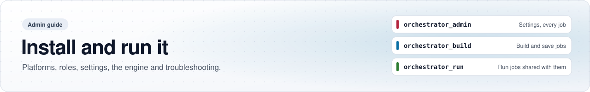
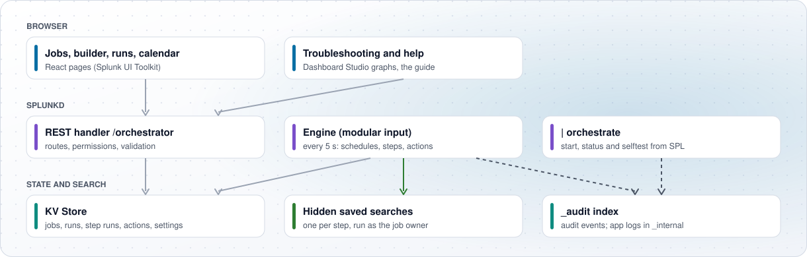

<p align="center"><picture><source media="(prefers-color-scheme: dark)" srcset="images/header-admin-dark.svg"></picture></p>

<p align="center">
  <a href="../README.md"><b>Home</b></a> ·
  <a href="user-guide.md"><b>User guide</b></a> ·
  <b>Admin guide</b> ·
  <a href="../CHANGELOG.md"><b>Changelog</b></a>
</p>

# Search Orchestrator: admin guide

This guide covers installing, securing and running the app. The [user guide](user-guide.md) covers building and running jobs, and the [changelog](../CHANGELOG.md) what each version changed.

| Set up | Secure | Run and watch | Reference |
|---|---|---|---|
| [Supported platforms](#supported-platforms) | [Roles and capabilities](#roles-and-capabilities) | [Settings page](#settings-page) | [REST API](#rest-api) |
| [Install](#install) | [How steps run](#how-steps-run-security) · [What the app stores](#what-the-app-stores) | [Audit index](#audit-index) · [Run health dashboard](#run-health-dashboard) | [Known limits](#known-limits) |
| [Upgrading from 1.0.x](#upgrading-from-10x) | [Deleting jobs](#deleting-jobs) · [Orphaned owners](#orphaned-owners) | [Logs and troubleshooting](#logs-and-troubleshooting) · [Self-test](#self-test) | [Search head clusters](#search-head-clusters) |


## Supported platforms

| Platform | Status |
|---|---|
| Splunk Enterprise 9.4 and later, standalone search head | Supported. Verified on Splunk Enterprise 10.6.1.1. |
| Splunk Cloud Platform, Victoria Experience | Supported. Checked with AppInspect's Cloud checks only; not run on a real Cloud stack. |
| Splunk Cloud Platform, Classic Experience | **Not supported.** |
| Search head cluster | Designed for it but **unit-tested only**. See [Search head clusters](#search-head-clusters). |

> [!NOTE]
> The app needs Python 3 (3.9 to 3.13), which ships with every supported version of Splunk.

### Custom page templates (Splunk 10.4 and later)

The app's pages use custom Mako page templates so they work on Splunk Enterprise 9.4. Splunk deprecated custom templates in 10.4, and AppInspect warns about them. They still work. A move to Splunk's built-in template is planned before Splunk removes custom templates.

## Install

1. Install `search_orchestrator-<version>.tgz` (from the [latest release](https://github.com/lyderhansen/search_orchestrator/releases/latest)) through **Apps > Manage Apps > Install app from file**, or Cloud self-service app install.
2. Restart Splunk if asked.
3. Create the audit index if it doesn't exist (see [Audit index](#audit-index)).
4. Give people roles (see [Roles and capabilities](#roles-and-capabilities)).
5. Open **Search Orchestrator > Settings** and set a fallback notification.
6. Check the health messages on the Settings page are gone.

> [!TIP]
> The engine is a modular input, `orchestrator_engine://main`, enabled by default. It starts on its own; there is no external scheduler. Run `| orchestrate selftest` as an admin to check the install (see [Self-test](#self-test)).

<p align="center"><picture><source media="(prefers-color-scheme: dark)" srcset="images/architecture-dark.svg"></picture></p>

## Upgrading from 1.0.x

A Results of earlier steps step saved before 1.1.0 may still have an Earliest and Latest, and so does its hidden saved search. Splunk applies that time range until the job is saved again. The Jobs page shows "Step <id>: re-save the job to drop this step's old time range" under such a job, and validation in the editor shows the same warning (`previous_old_time_range`). Open the job and save it; the save drops the time range and writes a new hidden saved search.

## Roles and capabilities

| Capability | Allows |
|---|---|
| `orchestrator_admin` | Manage every job, the settings and the webhook destinations. Run the self-test. |
| `orchestrator_build` | Create and edit their own jobs. |
| `orchestrator_run` | Start and control the jobs they may run, and view those runs. |
| `orchestrator_approve` | Approve or reject approval steps on runs they may see. |

| Role shipped by the app | Capabilities |
|---|---|
| `orchestrator_admin_role` | admin, build, run, approve |
| `orchestrator_builder_role` | build, run (imports `user`) |
| `orchestrator_user_role` | run (imports `user`) |
| `orchestrator_approver_role` | run, approve (imports `user`) |

`admin` and `sc_admin` also get all four. The builder, user and approver roles import Splunk's `user` role, so any one of them alone is enough to use Splunk Web. Give users a role by having their role inherit one of these, or add the capabilities to an existing role. The REST handler checks the capabilities on every request; hiding a screen is only a convenience.

**Approvals.** A user may decide an approval step when they hold `orchestrator_approve`, may see the job and, if the step lists roles, are in one of them; admins always may. The user who started a run may also decide a step that lists no roles, without the capability (audited `as_starter`). A custom role that holds `orchestrator_approve` without `orchestrator_run` sees no runs, so it can't find anything to approve: give it `orchestrator_run` too, or use `orchestrator_approver_role`.

**Who sees what.** Admins see everything. Anyone else sees the jobs they own or may run, including those jobs' SPL and run history.

## How steps run (security)

> [!IMPORTANT]
> Every step runs as its job's owner, with exactly the owner's roles and index access. Members of a job's "Who may run" roles start searches **as the owner**, but only the SPL the owner saved.

- **Steps run as the job owner.** Each step is a hidden private saved search owned by the job owner (named `_so_<job>_<step>_<hash>`), so it gets exactly the owner's roles and index access, never more. SPL conditions on lines (1.17.0) work the same way: `_so_<job>_cond_<hash>`, run as the owner when the line's source finishes, stopped after 300 seconds, and counted toward the running-search limits. They can't use writing commands.
- **"Who may run" lends the owner's access.** A job can list roles that may start it. Members of those roles (who also hold `orchestrator_run`) start searches that run **as the owner**, with the owner's access. They can only run the SPL the owner saved, and run parameters are type-checked. Every token, including values taken from search results, is substituted as one escaped, quoted SPL string, so it can't inject SPL commands or field names. The builder says this next to the setting.
- **Role names typed into "who may run" are not checked.** The picker offers the builder's own roles and accepts typed names. A typo saves fine and simply matches nobody.
- **An admin who saves someone else's job becomes its owner.** This is audited, and the builder asks first. It stops anyone changing SPL that runs under another person's identity.
- **Job-to-job chaining** (start-job actions and completion triggers) checks that the upstream job's owner may run the target job, and stops after a chain depth of 10.
- **Secrets.** Webhook URLs and headers are kept in Splunk's credential store (`storage/passwords`). The Settings page never shows them again after saving.
- **KV Store.** The `so_*` collections are readable and writable only by `admin` and `sc_admin`. All changes go through the REST handler. `so_job_versions` holds each job's saved versions (one document per version, pruned to 50) and is deleted with the job. `so_backfills` holds one document per backfill (its planned run times and progress). Backfill documents are kept; they are not pruned with run records or removed when the job is deleted. `so_snippets` holds one document per snippet, kept until its owner or an admin deletes it. **Every builder (and admin) can see and insert every snippet, including its searches**, whoever owns it; only the owner or an admin renames or deletes one. A snippet holds no secrets, because actions name a destination and its URL and headers stay in the secret store. `so_follows` holds one document per person following a job (the events and how to tell them), removed with the job.
- **Following a job.** Anyone who may see a job may follow it. Email goes only to the address on the follower's own Splunk account, read when it is sent (the account's `email`), through the fallback notification's system search, so a follower can't send mail to an address of their choosing; the message carries the job, outcome and run link, never results. Webhook destinations can be picked only by builders and admins. Each message is checked at send time: a follower who can no longer see the job gets nothing.
- **TLS.** Outbound webhooks always verify TLS. Calls from the app to its own splunkd over loopback (127.0.0.1) skip verification because splunkd's default certificate is self-signed; any other host is refused.

### Saved-search steps and the `| savedsearch` wrapper

A step that runs an existing saved search is dispatched directly only when the job owner owns it, it is private, and it runs as owner. Its own time range, summary indexing and alert actions then work as configured.

Anything else (a shared search, or one owned by someone else) runs through a hidden `| savedsearch "<name>"` search owned by the job owner, so it runs with the job owner's access. In this mode:

- the saved search's own summary indexing and alert actions **do not run**;
- the step's results are the saved search's results, so tokens and `loadjob` work as normal.

The builder warns about this when the job is saved. If you need summary indexing, put `collect` in the step's SPL instead.

Either way, the saved search must be shared globally or saved in the Search Orchestrator app; steps run in this app's context, so a search private to another app can't be used, and saving the job says so.

The engine checks a directly dispatched search again, with its own session, right before each run: if it is no longer the owner's private search with dispatchAs = owner, the step fails with a clear message instead of running. **Keep the app's default ACL (`[] write : [admin, sc_admin]` in `metadata/default.meta`).** It stops non-admins sharing objects into this app, which is part of what keeps a direct dispatch running as the owner.

### Alert action "Start orchestrator job"

The alert action starts a run with the alert's own session, so the alert's owner must be allowed to run the job. It refuses, and logs a clear error, when:

- the alert is owned by `nobody` (such an alert runs with the system user's session), or
- the session's user is not the alert's owner.

Assign the alert to a real user who may run the job. Errors go to splunkd's alert action log (`index=_internal sourcetype=splunkd component=sendmodalert`).

## What the app stores

The app keeps its own records in KV Store and runs every search through saved searches it creates for the job owner.

The same section is on the app's **Help** page, under How it works.

| What | Where |
|---|---|
| Jobs and their saved versions, runs, step attempts, action rows, commands from the pages, the engine lease, settings, backfills, snippets, follows, self-test scratch | KV Store, the 12 `so_*` collections (who may read them: see [How steps run](#how-steps-run-security)) |
| Each search a job runs: steps, SPL conditions on lines, search actions | Hidden saved searches owned by the job owner (below) |
| Search results | Splunk's own search jobs. Later steps read them by search ID with `loadjob`, so they last only as long as Splunk keeps the search job |
| Webhook URLs and headers | Splunk's password store (`storage/passwords`, realm `search_orchestrator`), never KV Store or logs |
| Audit events | `index=orchestrator` |
| The app's log | `_internal`, `search_orchestrator.*.log` |

### Hidden saved searches

Saving a job writes one saved search for each search the job runs, with the saving user's own session (that user becomes the job owner). All of them start with `_so_`:

| Used for | Name | Notes |
|---|---|---|
| Search step | `_so_<job>_<step>_<hash>` | The step's SPL with tokens filled in as arguments. |
| Results of earlier steps | `_so_<job>_<step>_<hash>`, two of them | One reads the earlier steps' results (`\| loadjob ...`); the other (description ends "(no inputs)") runs when no earlier step succeeded. |
| Saved search step | none, or `_so_<job>_<step>_<hash>` | None when the job owner owns the search and it is private: it runs as it is, and the app never edits or deletes it. Otherwise a wrapper running `\| savedsearch "<name>"`; see [the wrapper](#saved-search-steps-and-the--savedsearch-wrapper). |
| SPL condition on a line | `_so_<job>_cond_<hash>` | |
| Email, event and alert actions | `_so_<job>_action_<n>_<hash>` | |
| Fallback email | `_so_fallback_email` | Shipped with the app (`default/savedsearches.conf`), owned by `nobody`. |
| Self-test | `_so_so_selftest_...` | See [Self-test](#self-test). |

- **Private and owned by the job owner,** in this app. Their description says which job and step they belong to ("Search Orchestrator job `<job>`, step `<step>`"). A step therefore runs with the owner's permissions.
- **Never scheduled in Splunk.** The engine starts them when the job's lines say so. Don't schedule or edit them by hand: a schedule set in Splunk would run the step outside the job, and an edit is overwritten when the job is saved again.
- **Hidden from Reports only.** They are saved with `is_visible = 0`. That hides them from the app's **Reports** page (`/app/search_orchestrator/reports`), but not from **Settings > Searches, reports, and alerts** (`/manager/search_orchestrator/saved/searches`), where an admin sees every owner's. Filter on `_so_` there to find them.
- **Old versions are kept while a run may need them.** The hash in the name changes when the SPL or time range changes, so a save that changes a search writes a new one beside the old. The old one stays while a run uses it: an active or held run, or a failed or cancelled run that ended within the result retention in Settings, since it can be re-run with its original definition. A later save of the job removes the searches nothing needs any more. A delete that fails is logged (`hidden_search_delete_failed`) and tried again at the next save.
- **The job lists them.** The job record's `hidden_searches` holds every owner and name the app created for it, so none is lost if a save fails half way.
- **Deleting a job deletes them all**; see [Deleting jobs](#deleting-jobs).

## Settings page

Only users with `orchestrator_admin` see it.

| Setting | Default | Limits |
|---|---|---|
| Concurrent searches (all jobs) | 10 | 1 to 100 |
| Concurrent searches per job | 4 | 1 to 50 |
| Queue cap per job | 20 | 1 to 1000 |
| Keep step results after a run | 24 hours | 1 to 168 hours (7 days) |
| Keep run records | 90 days | 1 to 3650 days |
| Fallback notification | none | an email address or a webhook destination |
| Splunk Web address | empty | an http(s) URL; makes links in messages absolute |
| Events scanned limit | none | a whole number of events (`scan_limit`); a step can set its own (`max_scan`) |
| When a step goes over | Warn | Warn (audit `step_scan_limit`, the search finishes) or Stop the search (it is cancelled and the step fails, then retries if it has retries) |
| Building blocks | all on | any node kind except Search and Schedule can be turned off (`turned_off`) |

### Building blocks

Turn off what your teams don't use, to keep the builder simple. For example, turn off **Approval** if no one signs off on runs, or the webhook channels you have no destinations for. The kinds are grouped as in the builder:

- **Triggers:** After another job.
- **Steps:** Saved search, Results of earlier steps, Summary index, Lookup and Approval.
- **Actions:** Email, Webhook, Slack, Microsoft Teams, PagerDuty, ServiceNow, Event to an index, Alert action and Start another job.

A kind that is off:

- is no longer offered in the Flow editor's + menus, Quick add and search, or in the Simple editor;
- can't be added from **Browse examples**: an example that uses it says so, and can still be opened to look at;
- can't be added in a save: the save is refused with "Approval is turned off in Settings > Building blocks". This also covers the API and **Import jobs**.

Jobs that already use it keep running, and can still be edited and saved with it. Turning a kind off never breaks a job. Turn it back on at any time.

**Beta** marks blocks that are still in development and may not work yet: Approval, Webhook, Slack, Microsoft Teams, PagerDuty and ServiceNow. The tag shows here and in the builder's add menu.

**Health** shows whether the engine is running, whether the audit index exists, whether a fallback is set and how many commands are waiting, with a warning message for each problem.

### Webhook destinations

Admins define each destination once: a name, an `https://` URL, a body format (Generic JSON, Slack, Microsoft Teams, PagerDuty or ServiceNow) and optional headers such as `Authorization`. Job builders pick from the list by name and never see the URL. This keeps secrets out of jobs and stops builders pointing the search head at internal addresses.

The URL and headers are write-only. The page shows only whether each is set. To change a destination, use **Replace** and enter the URL again; leave the headers empty to keep them, or remove them. A destination used as the fallback can't be deleted until the fallback changes.

Body formats:

- **Microsoft Teams:** an Adaptive Card 1.4 message; use the URL of a Teams Workflows webhook.
- **PagerDuty:** an Events API v2 event. **New URL** may stay empty: a new destination then uses `https://events.pagerduty.com/v2/enqueue`, and replacing a PagerDuty destination keeps its stored URL (for example the EU endpoint `https://events.eu.pagerduty.com/v2/enqueue`). **Routing key** is required and write-only, like the URL: the page shows only whether one is stored, and an empty value keeps it. Take it from the service's Events API v2 integration.
- **ServiceNow:** a Table API incident. The URL must end in `/api/now/table/incident`; put the credentials in the headers (for example `Authorization`). Job builders set urgency, impact and assignment group (up to 100 characters) on each action.

**Splunk Cloud may block outbound webhooks.** If deliveries fail with connection errors, ask Splunk support to allow the destination host, such as `events.pagerduty.com` for PagerDuty and your ServiceNow instance's host.

### Fallback notification

A delay, failure or late run is never meant to be silent. When a job has no failure, delay or late action (hook `on_late`), or that action keeps failing, the engine sends the fallback notification. It carries only job, run and step names, status and links, and doesn't run as the job owner, so it still works when the owner's account is gone. Email uses Splunk's `sendemail`, so Splunk's mail server settings must be configured.

## Audit index

The engine writes every state change as JSON to the `orchestrator` index (sourcetype `orchestrator:audit`): jobs saved, runs and steps changing state, actions, permission denials and ownership changes.

- **Enterprise:** the app ships `indexes.conf` for the index.
- **Splunk Cloud:** create an event index named `orchestrator` yourself (**Settings > Indexes**). The app keeps working without it, because the screens read from KV Store, but audit events are lost and Settings shows a warning.
- Inside the app, search with the `orchestrator_index` macro. The macro isn't shared outside the app, so **outside the app, and on Cloud, search `index=orchestrator` directly.**

Run records (each run with its step attempts and action rows) are pruned from KV Store after the retention period; audit events stay for the index's own retention.

## Run health dashboard

The **Run health** dashboard (Dashboard Studio, view `run_health`) reads only through the app's macros, so it follows a changed index name:

- `orchestrator_index`: the audit index. Late runs come from `run_late` (with `deadline_at`); runs come from `run_created`, `run_state`, `run_held`, `run_dismissed` and `step_attempt`; steps from `step_dispatched`, `step_attempt` and `step_delayed`; actions from `action_done` and `action_failed` (`action_type`, and `preset` or `host` for Slack). `step_delayed` and the action `preset` field are new with this dashboard; in events written before them a delay counts only where the step had an *on delayed* action.
- `orchestrator_internal`: the app's lines in splunkd.log (`index=_internal sourcetype=splunkd`): the engine modular input (component `ExecProcessor`), the REST handler (`PersistentScript`; its lines start with `orchestrator_rest:`), the alert action (`sendmodalert`) and the search command (`ChunkedExternProcessor`). The search command writes most of its messages to the search's own `search.log`, which isn't in `_internal`.
- `orchestrator_search_process`: search processes in `_introspection` (`component=PerProcess data.search_props.sid=*`). The **Performance** section joins them to step attempts by search ID for **Peak CPU and memory per job**; the other Performance panels (**Runtime per job**, **Events scanned per job**, **Slowest steps by runtime**) read the `perf` numbers on `step_attempt` events, which runs from before 1.23.0 lack.
- `orchestrator_engine_process`: the engine process in splunkd's resource-usage samples (`index=_introspection component=PerProcess`, every 10 seconds). With the engine's splunkd.log lines and audit events it gives **Last engine activity**, which turns red when the engine hasn't been seen for 5 minutes. An idle engine writes no log lines or audit events, so without `_introspection` access the tile can turn red while the engine is fine.

**Peak CPU and memory** come from `_introspection` search-process samples, taken about every 10 seconds and only while resource usage introspection is on (`server.conf` `[introspection:generator:resource_usage]`, on by default; some containers and test instances turn it off). A role that can't read `_introspection` gets no rows rather than an error, so when the search finds nothing the app counts `_introspection` events of the last day: none means no access, and the tab says to ask an admin. Searches shorter than the sample interval have no numbers; runtime, events scanned, results and disk always come from the engine or `_audit`.

Viewers need read access to the audit index, `_internal` and `_introspection` (admin and sc_admin have it). The run page's **Performance** tab runs two searches as the viewer (CPU and memory from `_introspection`, and for steps from before 1.23.0 run time and counts from `_audit`); without access to either, the tab shows a note instead. The side-by-side test copy (`scripts/package_variant.sh`) suffixes all four macros and the script names they match, so each copy's dashboard shows only its own engine.

## Logs and troubleshooting

The app writes its own log files to `$SPLUNK_HOME/var/log/splunk`, one per process: `search_orchestrator.engine.log` (the engine) and `search_orchestrator.rest.log` (the REST handler behind every screen, the alert action and `| orchestrate`). splunkd indexes that folder into `_internal` by itself; nothing needs configuring. Each file rotates at 10 MB and keeps 5 old files. The app's `props.conf` gives them the sourcetype `orchestrator:log` (one event per line, a Python traceback kept with its line, `key=value` fields); lines indexed before 1.32.1 keep the sourcetype Splunk guessed (`search_orchestrator.<process>-too_small`). The side-by-side test copy writes `search_orchestrator_<suffix>.<process>.log`, so the two never mix.

Lines are `key=value`: `level`, `process`, `logger`, `event` and the ids involved (`run_id`, `job_id`, `step_id`, `sid`, `user`), plus `ms` for anything timed. What gets written depends on **Log level** in Settings (`log_level` in `PUT settings`; `ERROR`, `WARNING`, `INFO` or `DEBUG`, default `INFO`), read within 30 seconds without a restart:

| Level | Adds |
|---|---|
| ERROR | Failed ticks, failed requests and lost audit events, with the Python traceback |
| WARNING | Retries and skipped work: searches whose status could not be read, cancel failures, lease lost, server errors from requests; and the audit events that report a failure (failed or retried actions, failed steps and runs, searches that could not start, failed conditions, rejected runs and commands, delayed and late runs, held runs, denied permissions) |
| INFO | A copy of every audit event (job saved, run created, step dispatched, approval decided, action done …), changing requests (method, path, user, status, ms), engine start, stop, lease taken and standby, a `heartbeat` every 5 minutes from the engine holding the lease (`ticks`, `avg_ms`, `slowest_ms`, `active_runs` now and `peak_runs`, the most at once in the 5 minutes, `jobs`); why something waits, once until the reason changes: `run_waiting` (`reason` held, waiting_for_run or behind, with `by_run`), `step_waiting` (search slots full, with the limits) and `completion_not_fired` (a downstream job disabled, or the run ended the wrong way) |
| DEBUG | Each engine tick (ms, active runs, jobs), each search status check, every read request and every splunkd call (method, path, owner, status, ms) |

Lines never hold passwords, session keys, tokens, headers, request bodies, webhook URLs or search results; long values are cut at 500 characters. Warnings and errors still go to `splunkd.log` too (start and stop messages no longer do: splunkd records a modular input's stderr as ERROR), so the Run health dashboard's **Engine health** keeps working; the copies of audit events do not (they are in the audit index already).

The **Troubleshooting** page (`logs` view) uses four routes, all searching these lines as the caller, so the caller needs read access to `_internal`. Filters: `run_id`, `job_id`, `step_id`, `event`, `process`, `level`, `text`, `range` (15m, 1h, 24h or 7d) and, for lines, `limit` (up to 1000) and `sort` (`newest` or `oldest`).

- `GET logs`: the lines, each with its parsed `fields`, free-text `message` and `traceback`, plus `names` (job and step names for jobs the caller may see).
- `GET logs/summary`: per-bucket counts for the graphs (`timechart`: lines per level, requests per status class and their 95th percentile, tick time and active runs), the totals for the health tiles, the 15 most frequent events, the engine lease status and the log level.
- `GET logs/breakdown`: the 15 slowest API routes and splunkd endpoints (ids taken out) by 95th percentile.
- `GET logs/problems`: up to 2000 errors and warnings grouped by event, error code and error text with ids and numbers taken out. Search them yourself with the `orchestrator_logs` macro (`index=_internal source="*search_orchestrator.*.log"`).

## Step previews

The job editor can run a step and show its rows. See [Previewing steps](user-guide.md#previewing-steps).

- **Who:** `orchestrator_build` or `orchestrator_admin`, plus the right to edit the job. The REST handler checks this on every request.
- **Runs as the caller.** A preview is an ad-hoc search dispatched as the user, in the Search Orchestrator app namespace (`servicesNS/<user>/search_orchestrator`). It is never run as the job owner or the system user, and it sees only what that user can see. Search job ids are `so_preview_<user hash>.<job id or new>.<step id>.<random>`, so the Job Inspector and the jobs list show the job and step in the sid. Splunk's `POST search/jobs` has no parameter that sets a label (`label` is a job property it reports, not one a request sets), so preview jobs have none.
- **Auto-cancel:** 180 seconds. A running preview that nobody polls, such as after a closed tab, is cancelled. The margin covers browsers that slow timers in background tabs.
- **TTL:** 1800 seconds (30 minutes) once finished. The editor keeps it alive while it uses the preview.
- **Runtime cap:** the smaller of the step's max runtime and 600 seconds.
- **Rows:** the search isn't row-capped, so later previews read all rows. The table shows 100.
- **No actions.** A preview never sends actions. A saved-search step runs through the `| savedsearch` wrapper, so its own alert actions and summary indexing don't run.
- **Audit:** every preview writes `type=preview_dispatched` to `index=orchestrator`, with the job, step and sid.
- **Past runs as input:** a preview reads the run's step results with `loadjob`. They expire after the run's result retention (24 hours by default); the editor greys out runs past it. A step result Splunk won't show the caller (another owner's run, for a user Splunk doesn't let read it) fails with 403 `run_results_forbidden`, not "expired". To tell the two apart, the handler asks splunkd with the system session only whether that recorded sid still exists.

To see current previews:

```
| rest /services/search/jobs splunk_server=local count=0
| search sid="so_preview_*"
| table sid eai:acl.owner ttl
```

## Search head clusters

The engine runs on every member, and a KV Store lease (90 seconds, renewed about every 10 seconds and right before each search dispatch and action send; every engine call to splunkd times out after 15 seconds, so no call outlives the lease) makes sure only one member advances runs at a time. This was tested against a fake KV Store only; no real cluster was available. Watch the first runs after installing on a cluster.

## Deleting jobs

The Jobs page shows **Delete** to users who may edit the job: its owner (with `orchestrator_build`) and admins. It asks for confirmation, naming the job, then deletes the job, its hidden saved searches, saved versions and follows, and cancels a running backfill, so nothing of it runs again. A job with active or queued runs can't be deleted until those runs are cancelled; the dialog says so. Past runs stay in the Runs list until run-record retention prunes them.

## Orphaned owners

If a job owner's Splunk account is removed, that job's runs fail with a clear error. To recover, an admin opens the job in the builder and saves it. The admin becomes the owner (the builder asks first, and the change is audited), and the job's searches run as the admin from then on. The admin can then hand the job to someone else by having that person save it, if they hold `orchestrator_admin`, or by rebuilding it under their account.

## Self-test

`| orchestrate selftest` (admin only) checks a build on the server without any screens. It creates and runs small built-in jobs made of `makeresults` searches.

| Command | What it does |
|---|---|
| `\| orchestrate selftest` | Saves and runs job `so_selftest`: serial and parallel steps, tokens, `loadjob`, a skipped step, a retry, and a Results of earlier steps step (`merged`) whose single row step `merged_check` verifies. |
| `\| orchestrate selftest scenario=rollup_late` | Daily, weekly and monthly rollup with a slow daily, to show waiting, the delay alert and a late start. Optional `slow_n=<number>` (50,000 × slow_n hashes, default 600, about 40 seconds on a test server; at most 100000) and `delayed_after=<seconds>`. |
| `\| orchestrate selftest scenario=rollup_fail` | The same rollup with a daily that fails once, to try re-run from a step. |
| `\| orchestrate selftest scenario=probe` | Checks the server calls the app depends on (search history, job control, KV Store, users, saved searches, index checks, audit writes, the REST endpoint) and returns one row per check with `ok` and `detail`. It never prints secrets. |

Follow a run with `| orchestrate status run="<run id>"`, or on the Runs page.

A job runs one run at a time, so a self-test run waits while another run of the same self-test job is running, blocked or paused, or is queued and goes first (re-runs first, then by scheduled time). The command then says so: `queued behind run <id>, which is blocked: cancel it with | orchestrate cancel run="<id>"`, with the run in `queued_behind` and its state in `queued_behind_state`.

**What it leaves behind.** The self-test jobs stay after they run, so they can be run again:

- jobs `so_selftest`, `so_selftest_rollup_late` and `so_selftest_rollup_fail` (the probe also saves `so_selftest`), with their runs;
- their hidden saved searches (`_so_so_selftest_...`), private to the admin who ran the test;
- audit events and `collect`ed test events in the `orchestrator` index;
- the probe's scratch documents are written to the `so_selftest` KV Store collection and deleted straight away.

To remove them, use **Delete** on the Jobs page for each `so_selftest*` job. Deleting a job also deletes its hidden saved searches. A job with active or queued runs can't be deleted; cancel those runs first. The REST equivalent is `DELETE /services/orchestrator/jobs/<id>`.

Run records are pruned with the normal retention.

### App health alerts

`default/savedsearches.conf` ships three alerts, all **disabled** (`disabled = 1`), readable and writable by `admin` and `sc_admin` only. Turn one on in **Settings > Searches, reports, and alerts** (app Search Orchestrator, **Edit > Enable**), or from the app's **Settings > Health**. Each searches the `orchestrator_logs` macro over the last 15 minutes, returns rows only when something is wrong and tracks a Triggered Alert (digest mode); add an email or other action to be told. They run as the alert's owner (nobody, so splunk-system-user), which can read `_internal`.

| Alert | Search | Schedule | Suppressed |
|---|---|---|---|
| Search Orchestrator - Engine not running | no `heartbeat`, `lease_acquired` or `ticks_resumed` line from the engine | `*/5 * * * *` | 1 hour |
| Search Orchestrator - Missed schedules | `schedule_missed` lines: missed runs, jobs, longest gap | `*/15 * * * *` | no |
| Search Orchestrator - Errors | `level=ERROR` lines: how many, which events and processes | `*/15 * * * *` | 1 hour |

On a search head cluster the engine heartbeat comes from the member holding the lease, so the engine alert fires only when no member runs the engine. Turning an alert on is a local change (`local/savedsearches.conf`) and survives upgrades.

## REST API

All routes are under `/services/orchestrator/` (or `/servicesNS/-/search_orchestrator/orchestrator/`) and return JSON. Each checks the caller's capabilities.

| Route | Methods |
|---|---|
| `jobs`, `jobs/<id>` | GET, POST, PUT, DELETE (GET adds `next_run`, `last_run`, `recent_runs` and `warnings`, such as `missing_target_job`, `disabled_target_job` and `missing_upstream_job`; these and `permissions` are ignored when sent back with a save) `GET jobs` takes `q` (part of a name); with `limit` (at most 50) and `offset` it returns one page and `total`; `brief=1` leaves out next and last runs. |
| `jobs/validate` | POST |
| `jobs/<id>` (PUT) | A save may send `_base_revision`, the job's `revision` when the editor opened it. If the job changed since (a save, enable or disable, or tags), the answer is 409 `job_changed` with `revision`, `updated_by` and `updated_at`, and nothing is saved. Without it, the save overwrites, as before. Every job has a `revision`, counted by the server; jobs saved before 1.49.0 start at 0. |
| `jobs/<id>/enabled` | POST (`enabled` true or false; keeps the owner and the definition) |
| `jobs/<id>/tags` | POST (`add` and `remove`, lists of tags, matched ignoring case; keeps the owner and the definition; 400 `bad_tags` when the result breaks the tag rules. Audit event `job_tags_changed` with `added` and `removed`) |
| `jobs/<id>/runs` | POST (start a run: `params`, optional `scheduled_time`; `strict_params: true` refuses undeclared parameters, otherwise they are dropped) |
| `runs`, `runs/<id>` | GET. `GET runs` takes `q` (part of a job's name, or an exact job ID), `job_id`, `state` and `limit`. |
| `runs/<id>/pause`, `resume`, `cancel`, `dismiss`, `rerun` | POST |
| `jobs/<id>/follow` | GET, PUT (`on`: any of `failure`, `late`, `delayed`, `success`; `notify`: `{"type": "email"}` or `{"type": "webhook", "destination"}`), DELETE: the caller's own follow; `GET jobs` adds `following` |
| `runs/bulk` | POST (`action` `cancel`, `pause`, `resume`, `dismiss`, `rerun`, `approve` or `reject`, `run_ids` 1 to 100, `comment` required to reject; each run is checked as its own route would, so the answer is 200 with `results`: `run_id`, `ok` and, when not, `code` and `message`. A re-run starts from the run's first failed step with the original definition; approve and reject decide every step the run waits on. Audit event `bulk_run_action`) |
| `runs/<id>/approve` | POST (`step_id`, `decision` `approve` or `reject`, `comment` up to 1000 characters and required to reject; needs `orchestrator_approve`, or the run's starter on a step with no roles; 409 `not_awaiting_approval` when the step isn't waiting or is already decided) |
| `settings` | GET, PUT (admin) |
| `destinations`, `destinations/<name>` | GET, POST, DELETE (admin; builders may list) |
| `health`, `me` | GET (`me` includes `can_approve`) |
| `selftest` | POST (admin) |
| `schedule/next` | POST (builders: `cron`, optional `timezone` and `count` 1 to 10; returns the next `slots`, each slot's `utc_offsets`, the `timezone` used or null for server time, and `timezone_status`; with `clashes: true` (and `job_id` to leave out), per slot the other enabled jobs you may see that fire in the same minute) |
| `schedule` | GET (any app capability; `from` and `to` epoch seconds, by default 8 hours back to 16 hours ahead; returns every job's past, running and projected runs as `bars` and the concurrent-search `load` with `max_searches`; jobs the caller may not see are listed as `Hidden job N`, so the load is the real one) |
| `schedule/preview` | POST (builders who may edit the job: `job`, a draft; returns the other jobs' `load` around the draft's cron schedules, in its time zone, and per schedule its `runs` and an optional quieter `suggestion`) |
| `jobs/<id>/versions` | GET (a job's saved versions, newest first; `version=<n>` returns one with its definition; `compare=<a>,<b>` returns the changes, `b` a number or `current`) |
| `jobs/<id>/restore` | POST (`version`: saves that version as a new version; needs the right to edit the job) |
| `preview/condition` | POST (builders: tests one condition line now, as the caller like a preview; see [Test condition](user-guide.md#test-condition)) |
| `preview/output` | POST (builders for a job, viewers for a run: a read-only search of what a Lookup or Summary index step or an email or event action wrote, as the caller like a preview; see [Write results to an index or a lookup](user-guide.md#write-results-to-an-index-or-a-lookup)) |
| `jobs/<id>/backfills` | POST (builders who may run the job: `from`, `to`, `source` `schedule` or `step`, `step` in seconds, `concurrency` 1 to 5, `params`; `dry_run: true` returns the planned `slots` and stores nothing) |
| `backfills` | GET (`job_id`, `state`; newest first, without slots) |
| `backfills/<id>` | GET (the backfill and its runs) |
| `backfills/<id>/cancel` | POST (the creator, anyone who may edit the job, or an admin; cancels the group) |
| `calendar` | GET (any app capability; `from` and `to` epoch seconds at most 8 days apart, optional `job_id`; returns `items` of kind `scheduled`, `run` or `backfill` for the jobs the caller may see, and `truncated` when there are more than 2000 items; at most 300 scheduled slots per job) |
| `snippets` | GET (builders and admins; every snippet without its content), POST (`name` of 1 to 80 characters, unique ignoring case, optional `description` up to 500, and `content` in the copy format of at most 100 steps and 200 KB; 409 `snippet_exists`) |
| `snippets/<id>` | GET (with content), PUT (rename only: `name`, `description`; the owner or an admin), DELETE (the owner or an admin) |
| `runs/<id>/performance` | GET (`steps` keyed by step id with the stored `perf` numbers and, when readable, `cpu_peak`, `cpu_avg` and `mem_peak_mb`, plus `notes`; the two searches run as the caller with a 30 second limit and cover at most 50 searches) |
| `timerange/resolve` | POST (builders: `earliest`, `latest`, `scheduled_time`; returns the epoch window they cover) |

## Known limits

- An approval waits 5 minutes to 7 days, and its message is at most 500 characters. A decision is applied on the engine's next tick, not at once.
- The **Dependencies** page is built in the browser from `jobs`, so it shows only jobs the user may see; a job it can't see appears as "Job you can't see". The **Calendar** page reads `calendar` and shows only future scheduled times of turned-on jobs, at most 300 per job and 2,000 items per request, over at most 8 days.
- Not tested on a real search head cluster or a real Splunk Cloud stack.
- Classic Experience Cloud stacks are not supported.
- Custom page templates are deprecated from Splunk 10.4; migration is planned.
- Node positions in the builder are not saved.
- A backfill holds at most 100 runs over at most 400 days, with 1 to 5 queued at once. Deadlines apply only to on-time scheduled runs and runs started by another job.
- Version history keeps the newest 50 versions of each job; older ones are pruned and audited as `job_versions_pruned`.
- No per-step workload pool: the dispatch endpoint rejected it.
