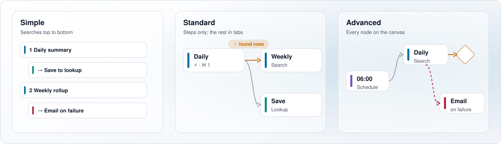

<!-- github-only -->
<p align="center"><picture><source media="(prefers-color-scheme: dark)" srcset="images/header-user-dark.svg"></picture></p>

<p align="center">
  <a href="../README.md"><b>Home</b></a> ·
  <b>User guide</b> ·
  <a href="admin-guide.md"><b>Admin guide</b></a> ·
  <a href="../CHANGELOG.md"><b>Changelog</b></a>
</p>
<!-- /github-only -->

# Search Orchestrator: user guide

Search Orchestrator makes dependent searches run as one unit, so a weekly rollup never runs on top of an unfinished daily summary. Admins: see the [admin guide](admin-guide.md).

<!-- github-only -->
> [!TIP]
> The same guide is built into the app: **Help** in the app bar, with an illustration under every section and **Learn more** links from the pages.

| Get started | Build jobs | Follow runs | Reference |
|---|---|---|---|
| [Words used](#words-used) | [Build a job](#build-a-job) | [Follow runs](#follow-runs) | [The `\| orchestrate` command](#the--orchestrate-command) |
| [Example jobs](#example-jobs) | [Simple, Standard and Advanced](#simple-standard-and-advanced) | [Dependencies](#dependencies) | [Audit events](#audit-events) |
| | [Triggers](#triggers) · [Actions](#actions) | [Calendar](#calendar) · [Backfill](#backfill) | [How it works](#how-it-works) · [What the app stores](#what-the-app-stores) · [Search slots](#search-slots) |
| | [Conditions](#conditions) · [Deadline](#deadline) | [Re-run from a step](#re-run-from-a-step) · [Troubleshooting](#troubleshooting) | [Help in the app](#help-in-the-app) |
<!-- /github-only -->

## Words used

- **Job:** a graph of search steps, with triggers, parameters and actions.
- **Step:** one search in a job. A step starts only when the steps it depends on have finished.
- **Run:** one launch of a job. Each run keeps a copy of the job as it was when the run started.

You need `orchestrator_build` to create jobs and `orchestrator_run` to start them. Ask your Splunk admin.

## Example jobs

**Browse examples** on the Jobs page (also offered when there are no jobs) shows 6 ready-made jobs that use only data every Splunk has (`_internal`, `_audit`, `| makeresults`, `| rest`): one for each builder view's level.

- **A tab per view:** Simple, Standard and Advanced. **Open in builder** opens an example in its view, as a new, unsaved job to look at and save.
- **A picture of each job:** every card draws the job's flow, as on the builder's canvas, so you can see its shape before you open it.
- **Add as a job** saves one, with its id starting `example_`; **Add all examples** saves every one that isn't a job yet. Existing ones are skipped and errors are listed.
- **Examples that use other examples** (a Start job action, or After another job) bring those along: Add and Open in builder add them first, so the links point at real jobs. The card says which ("Uses Hourly splunkd errors and Daily, weekly and monthly rollup, added with it").
- Every example is scheduled but **turned off**, and tagged `example` and its view. Turn one on from its Settings when you're ready. Email actions go to `you@example.com` until you change them.

| View | Examples |
|---|---|
| Simple | Hourly splunkd errors |
| Standard | Daily, weekly and monthly rollup · Investigate only when errors were found |
| Advanced | Retries, recovery and clean-up · Chained jobs · Platform health pipeline (everything) |

**Platform health pipeline** is the showcase: four checks in parallel merge into a health score kept in a lookup, with all three kinds of condition, an approval gate, retries, a delay alert, a deadline and a chained job.

## Build a job

Open **Jobs**, then **Create job**.

A new job starts blank. To start from a ready-made job instead, use **Browse examples** on the Jobs page (see [Example jobs](#example-jobs)).

The first tab, **Flow**, shows the job in one of three views (see [Simple, Standard and Advanced](#simple-standard-and-advanced)). In **Advanced**, the job is drawn as nodes and lines, read from left to right: triggers, then steps, then the actions their outcomes lead to. See [The flow editor](#the-flow-editor). The steps below are for Advanced.

1. **Add nodes** with **Add node**, or press `/` with the canvas focused, and type what you want, such as "email". Or drag a line from the **+** handle on the right of a node and let go on empty canvas: the box then offers only nodes that line can lead to, and the new node is connected to it.
2. **Connect nodes** by dragging from a node's **+** handle onto another node. A line between two steps makes the second depend on the first; a line to an action says when the action fires. Keyboard and screen-reader users can use **Depends on** in a step's panel, and **When** in an action's panel.
3. **Select a node** to edit it in the side panel: a step's search, time range, run-when rule, delay and give-up times and retries; an action's fields; a trigger's schedule; a condition's check.
4. Use the other tabs for parameters, who may run, and job-wide settings such as the time zone and step defaults.
5. **Save.** The builder checks for cycles, unknown tokens, bad cron, unreadable saved searches and tokens from steps that might be skipped.

**If someone else saved the job after you opened it,** Save stops and asks first instead of replacing their changes: **Reload their version** opens what they saved (your unsaved changes are lost), and **Save mine anyway** replaces it with yours. Turning the job on or off and changing its tags count as changes too.

**The job is checked as you edit it**, so there is no Validate button. Each tab shows how many problems it has. If a save fails, every problem is listed with a **Go to ...** button that opens the right tab and selects the node that has the problem. If you leave with unsaved changes, the builder asks first.

Where you put nodes is saved with the job. Nodes you never moved are placed for you. Moving nodes does not count as changing the job when you re-run a step.

### Simple, Standard and Advanced

<!-- github-only -->
<p align="center"><picture><source media="(prefers-color-scheme: dark)" srcset="images/views-dark.svg"></picture></p>
<!-- /github-only -->

The first tab, **Flow**, has three views of the same job, switched with **Simple**, **Standard** and **Advanced** above it; the tab has the same name in all three. Switching never changes the job. The choice is remembered in this browser for jobs you open; a new job, and a job with no choice yet, opens in **Standard**.

| View | What it shows | Good for |
|---|---|---|
| **Simple** | The searches top to bottom, each starting when the one above succeeds | A chain of searches with a few saves and messages |
| **Standard** | The steps on a canvas with the lines between them; triggers on the **Triggers** tab and each step's actions in its panel | Most jobs: everything Advanced can do, with less on the canvas |
| **Advanced** | Every trigger, step, condition and action as a node | Seeing and wiring the whole job at once |

**Simple is locked** for a job it can't show, such as one with an approval step, more than one trigger or a line that runs on failure. Its button shows a lock; clicking it says why ("Simple can't show this job: an approval step. Use Standard or Advanced.") and keeps the view you are in.

#### Standard

- **The canvas** shows only the steps: searches, saved searches, results of earlier steps, summary index and lookup writes, and approvals. A line between two steps makes the second wait for the first. A line on failure reads **✗ Fails**, either way **∞ Either way**, and a condition reads **◇** and the condition. Click a line to change when it runs or its condition, test the condition, or remove it.
- **Add and connect steps** with a step's **+**, as in Advanced, but it offers steps only (actions are added in the step's panel): click it and pick when (Succeeds, Fails, Finishes either way, If…) and then a step; drag it onto empty canvas to add a step there; or drag it onto another step to connect them. **Add step** above the canvas adds a step on its own. Only kinds your admin hasn't turned off are offered.
- **Small marks on a step** show what is off the canvas: **⚡** a trigger starts it, **✉ 2** it has two actions, **⌛** it has a delay alert.
- **A step's panel** has its settings and, below them, **Actions**: each action with when it fires (Starts, Succeeds, Fails, Finishes either way, Is delayed; on an approval, Approved, Rejected and Asks for approval) and what it does. **Add action** picks when and what; click an action to change its fields and retries, move it, or remove it.
- Whole-job actions are on the **Job actions** tab, as in the other views.
- **Go to** on a problem with one of a step's actions selects the step and opens that action in its panel; on a condition it selects the line. A trigger problem opens the **Triggers** tab.
- **Groups** are drawn in Advanced only: they are frames placed around Advanced's nodes, so Standard leaves them out and keeps them as they are in the job.

#### The Triggers tab

In every view, the **Triggers** tab has a card for each schedule or *after another job* trigger, with the same settings as a trigger node in Advanced (the next run times, the busy-times strip and the quieter-time hint), and **Starts**: the first steps it starts. **Add schedule** and **Add after another job** add one. Trigger problems are counted on this tab. In Advanced, the triggers are also nodes on the canvas.

#### Simple

- **Simple** lists the searches top to bottom. Each starts when the one above succeeds. Click a search to change its name, what it searches (its own data, or the results of the search above), the search and the time range, and to preview it, move it or remove it. **+ Add search** adds one at the end.
- **+ Add…** under a search adds what happens, and when: pick **When this search…** **Succeeds**, **If a condition is true**, **Fails**, **Finishes either way**, **Starts** or **Is delayed** (the same choices as the + in Flow), then **Save to summary index**, **Save to lookup**, **Email**, **Post to Slack**, **Post to Teams**, **Page PagerDuty**, **Open a ServiceNow incident** or **Write an event**. Saves are offered only for **Succeeds** and a condition; the others send messages. The items are listed under a heading for each choice.
- **Only if it found results** (on **Succeeds**) sends or saves only when the search returned rows.
- **If a condition is true** has a **Condition** field: a comparison, as on an If… line, such as `$count.resultCount$ > 100`.
- A failed search stops the run. Slack, Teams, PagerDuty and ServiceNow need a destination your admin has set up.
- **Settings** on a row opens all its fields: an email's subject and message (with **Insert value** for tokens), a webhook's destination and its PagerDuty or ServiceNow options, an event's payload, a summary index's source and run id marker, or a lookup's append. **View output** shows what it wrote.
- **Starts** is the job's schedule, or another job it runs after. **If any step fails** tells someone about any failure in the run. **When done** starts another job, so jobs chain.
- Use **Edit in Advanced** for what Simple can't show.

### The flow editor

Each kind of node has its own shape and colour. The colour is a stripe on the left and the icon; it never says whether something worked.

| Node | Shape | Colour |
|---|---|---|
| Triggers: **Schedule**, **After another job** | rounded ends | purple |
| **Search**, **Saved search** | rounded corners; a saved search has a second stripe | blue |
| **Results of earlier steps** | cut corners | teal |
| **If…** (a condition) | diamond | amber |
| Notify: **Email**, **Webhook**, **Slack**, **Microsoft Teams**, **PagerDuty**, **ServiceNow**, **Alert action** | notched right edge | pink |
| **Approval** | octagon | amber |
| Write: **Summary index**, **Lookup**, **Event to an index** | cylinder | orange |
| **Start another job** | slanted sides | slate |

**The + handle.** A step has one input on its left and one round **+** on its right edge, shown when you point at the node, select it or focus it. Each **If…** node has a + too.

- **Click +** to open the **When** list: what has to happen to this node for the next one to run or fire. Each row shows how many lines already use it, for example "2 lines". Choose one, then pick a node in the search box below it: the new node is placed to the right of this one, in the first free spot, and connected with that outcome. `Escape` closes the list at any point.
- **Drag from +** to draw a line. Drop it on another node and the When list opens with only the outcomes that can go there; when only one can, the line is made without asking. Drop it on empty canvas and the When list and the search box open together; the new node lands where you dropped the line.

| When this node… | Symbol | A line to a step | A line to an action |
|---|---|---|---|
| Succeeds | ✓ | runs it when this step succeeds | fires on success |
| Fails | ✗ | runs it when this step fails | fires on failure |
| Finishes either way | ∞ | runs it whenever this step finishes | fires on complete |
| Starts | ▶ | not allowed (actions only) | fires on start |
| Is delayed | ⏱ | not allowed (actions only) | fires when the step is delayed |
| Asks for approval | ⚑ | not allowed (actions only) | fires when an **Approval** step starts waiting |
| If a condition is true | ◇ | adds an **If…** node; the next step runs when its condition is true (see [Conditions](#conditions)) | not allowed |

Actions for the whole job (it fails, succeeds, is late) aren't on the canvas: they are on the **Job actions** tab; see [Actions](#actions). Trigger nodes have no +: a dashed line goes from each trigger to every step that has no step before it, because those are the steps it starts. An action takes exactly one line in. A line that isn't allowed, such as one that would make a loop, isn't made.

**Outcome tabs.** Every outcome a node already uses shows as a small round tab on its right edge: just the symbol (✓ ✗ ∞ ▶ ⏱ ◇) in a ring in the outcome's colour. Point at a tab to see its name, such as "Succeeds" or "Fails"; screen readers read the name too. Its lines leave from that tab, and lines are coloured by outcome. Dragging from a tab draws another line with that outcome, without the When list. The tabs stack in a column centred on the node's middle, with the + to their right.

**Line labels and the line menu.**

- Lines carry no label by default, so the canvas stays quiet; a line's colour shows its outcome.
- The **selected** line shows its label in the middle ("✗ Fails"). A line out of an **If…** node shows its condition, shortened: the expression itself, "◇ where …" for an SPL expression or "◇ search …" for a search.
- **View** → **Line labels** in the toolbar draws a label on every line; choose it again to turn them off (remembered in this browser). Labels hide when you zoom out below 70 %, except on the selected line.
- On the run page, row counts such as "1 204 rows →" show on data lines while the toggle is on, or while the line is flowing.

Click a line, or press `Enter` on a focused line, to select it and open its menu:

- **Change to …** gives the line another outcome. On a line to an action this changes when the action fires; it stays on the same node. "If a condition is true" turns a line between steps into an **If…** node. On the line into an **If…** node, choosing another outcome turns it back into a plain line and drops the expression. Each change is one undo step.
- **Insert a node** (lines between two steps) opens the search box and puts the new step on the line.
- **Move … onto this line** (lines between two steps) puts a step that has no lines yet on the line, where it is; up to five such steps are listed. This is the keyboard way to drag a node onto a line.
- **Remove line** (lines between steps and **If…** lines). An action's line can't be removed, because an action always belongs to a step or the whole job; change its outcome instead, or move it in the action's panel.

**Put a node on a line.** Drag a step that has no lines yet onto a line between two steps; the line lights up.

- When you drop it, A → B becomes A → new step → B. A → new step keeps the line's outcome; new step → B is Succeeds.
- A line out of an **If…** node can't be split.
- Because B now runs after the new step, a message says what changed, for example "Weekly rollup now runs after Filter hosts succeeds. Undo brings back the old line." It has an **Undo** button and goes away after 10 seconds.
- **Insert a node** in the line menu does the same.

**Auto-pan.** While you drag a node or a line near the edge of the canvas, the canvas scrolls toward that edge, faster the closer you are.

**Toolbar and side panel.**

- **Left of the toolbar:** **Add node**, **Arrange** (**Tidy up**, **Group selection**) and **View** (**Node types**, **Grid**, **Line labels**, **Compact nodes**, **Side panel**).
- **Right of the toolbar:** the zoom buttons with the zoom level, **Frame all**, **Reset view** and **Full screen**.
- **Side panel:** hide it with **›** at its top (or **View** → **Side panel**) and bring it back with **‹**. Drag its left edge to make it wider or narrower (260–800 px), or focus the edge and use the arrow keys, `Home` and `End`; double-click the edge for the default width. Both are remembered in this browser.

**Full screen.** The canvas fills the window below the page header (at least 480 px tall), and the side panel scrolls beside it. **Full screen** in the toolbar shows the canvas and the side panel over the whole page; **Leave full screen** or `Escape` goes back. `Escape` first closes an open list or menu, or clears the selection.

**Keys**, with the canvas focused:

- `Tab` moves through the nodes, then the lines. `Enter` selects the focused one. On a focused line, `Enter` also opens its menu.
- `+` or `Shift+Enter` on a focused node opens its When list. Arrow keys move in the list, `Enter` chooses, then the search box takes over; `Shift+Tab` goes back to the list.
- `/` opens the add-node box, also from the toolbar. `Tab` opens it too while the pointer is over the canvas. Type to filter, arrow keys to move, `Enter` to add, `Escape` to close.
- Arrow keys move the selected node by 10 px. `Delete` or `Backspace` asks before removing it; **Undo** brings it back. The full list is under Keyboard shortcuts below.
- `F` frames the whole graph. Drag the background to pan, and use the wheel or the zoom buttons to zoom. The wheel zooms in proportion to how far you scroll, so a trackpad zooms smoothly.
- A new search step starts with the time range **The 24 hours before** (earliest `-24h`, latest `now`); change it in the step's panel. Existing, imported and pasted jobs, and saved search steps, are not changed.

**Data and signal lines.** A thick line carries data: it ends at a **Results of earlier steps**, **Summary index** or **Lookup** step, which read the results of the step it comes from. A thin line is a signal: it only says when something runs or fires, such as a line to an action or a dashed line from a trigger.

**Node types and the minimap.** **View** → **Node types** in the toolbar opens a legend with the shape and colour of each kind of node, the When outcomes with their symbols, and an example + and tab; choose it again to close it. When the graph is bigger than the canvas, a minimap appears. Drag in it to move the view.

**Arrange** → **Tidy up** in the toolbar places every node again automatically, as one undo step. Moving a node is one undo step per move.

The time zone every schedule uses is on the **Settings** tab; a schedule's panel links to it.

#### Select several nodes

- **Shift+click** a node to add it to the selection or take it out. **Shift+drag** on empty canvas draws a box and selects every node it touches. `Ctrl+A` (`Cmd+A` on a Mac) selects every node; `Shift+Space` toggles the focused node.
- Drag any selected node to move them all together. Only the main mouse button drags.
- The side panel shows "N nodes selected" with **Align left**, **Align centres**, **Align right**, **Align top**, **Align middles**, **Align bottom**, **Distribute horizontally** and **Distribute vertically**. The two distribute buttons need three or more nodes ("Select three or more nodes"). **Tidy up selection** places only the selected nodes again.
- **Remove nodes** (or `Delete`) asks "Remove N nodes?" and lists their names. **Undo** brings them back.

#### Duplicate, copy and paste

- `Ctrl+D` (`Cmd+D`) duplicates the selected nodes next to the originals. `Ctrl+C` and `Ctrl+V` copy and paste, also into another job in the same browser.
- Pasted nodes get new ids when an id is already taken. Lines between the pasted nodes come with them; lines to nodes you didn't copy don't. A message such as "Pasted 3 nodes" has an **Undo** button, and says when a pasted step still needs a line into it.
- **Paste** in the canvas menu puts the nodes where you right-clicked.

#### The right-click menu

Right-click a node, a selection or the empty canvas, or press the `Menu` key or `Shift+F10` on a focused node. The menu offers, depending on what you clicked:

- Empty canvas: **Add node here**, **Paste**, **Tidy up**.
- A node: **Rename**, **Duplicate**, **Copy**, **Save as snippet**, **Preview**, **Add a line**, **Remove**. An item that can't be used is dimmed and says why.
- Several nodes: **Duplicate**, **Copy**, **Save as snippet**, **Align…**, **Distribute…**, **Tidy up selection**, **Group**, **Remove nodes**.

`Escape` closes the menu.

#### Snippets

A snippet is a named copy of some nodes that every builder can insert into any job. It holds exactly what a copy holds: the nodes, their lines and their searches. Secrets stay in destinations, so a snippet only names the destination an action uses.

- **Save as snippet** is in the right-click menu of a node or a selection (also the `Menu` key or `Shift+F10`), and in the side panel when you select several nodes. Give it a name of up to 80 characters (names are unique, ignoring case) and an optional description of up to 500. The dialog says: "Everyone who can build jobs can see and insert this snippet, including its searches." A snippet holds up to 100 steps and 200 KB.
- **Insert** a snippet from the **Snippets** section of the quick-add box (**Add node**, `/`, or **Add node here**); type to find one by name or description. Snippets don't appear when the box is opened from a **+** handle, because they carry their own lines. Pasted nodes get new ids when an id is taken, and inserting is a single undo step.
- **Snippets…** in the builder toolbar lists them with **Rename** and **Delete**. Only the snippet's owner or an admin sees both; **Delete** asks "Delete snippet X?". Jobs that already hold a snippet's nodes keep them.

#### Grid and alignment guides

**View** → **Grid** in the toolbar draws a grid behind the nodes, and moved nodes snap to it; choose it again to turn it off. While you drag a node, thin guides appear when its edge or centre lines up with another node, and it snaps to them.

#### Compact nodes

**View** → **Compact nodes** in the toolbar shrinks every node to its name and icon, so a big graph fits on screen; choose it again to bring the detail back. It changes only how nodes are drawn, not the job.

#### Results on nodes

After you use **Preview step**, its node shows the result under the name: "1 204 rows · 3.2 s". While it runs the node says "Previewing…". When the step, the time, the parameters or an earlier step changed since, it says "Out of date" in muted text. A failed preview shows "Preview failed: " and the first line of the error. A bar shows the row count relative to the largest preview.

#### Groups

A group is a coloured backdrop that gathers nodes under a title. It never changes how the job runs.

- Select nodes and press `Ctrl+G` (`Cmd+G`), choose **Arrange** → **Group selection** in the toolbar, or right-click and choose **Group**.
- Click the group to edit its **Title**, **Colour**, **Width** and **Height** in the side panel. With the group selected, `Shift+arrows` resize it.
- **Collapse** shrinks the group to its title bar and hides its nodes; **Expand** shows them again. A faint dashed outline shows the area the collapsed group covers: drop, add or paste a node there and the group expands, so the node stays in view. The run page always shows groups expanded.
- **Remove group** asks "Remove group …?". The nodes in it stay.

#### Keyboard shortcuts

With the canvas focused:

| Keys | What they do |
|---|---|
| `Tab` | Move through the nodes, then the lines |
| `Enter` | Select the focused node or line; open a line's menu |
| `+` or `Shift+Enter` | Open the When list of the focused node |
| `Shift+Space` | Add the focused node to the selection or take it out |
| `Ctrl+A` / `Cmd+A` | Select every node |
| `Ctrl+C`, `Ctrl+V`, `Ctrl+D` (`Cmd` on a Mac) | Copy, paste, duplicate |
| `Ctrl+G` / `Cmd+G` | Group the selected nodes |
| `Delete` or `Backspace` | Remove the selection, after you confirm |
| Arrow keys | Move the selection by 10 px |
| `Shift+arrows` | Resize the selected group |
| `F` | Frame the whole graph |
| `/` | Open the add-node box |
| `Menu` or `Shift+F10` | Open the right-click menu |
| `Escape` | Close a list or menu, clear the selection, leave full screen |

### Write results to an index or a lookup

**Summary index** and **Lookup** are steps that write the results of earlier steps. Draw a thick line from the step whose results you want, then select the node. Both are **Results of earlier steps** steps underneath, and they take their input from the steps they depend on. **Depends on** in the side panel lists them.

- **Summary index** has **Summary index** (the index to write to), an optional **Source**, and **Add the run id**, which is on by default. The step's search is generated from these settings, for example `| collect index=summary source="daily" marker="so_run=$run.id$"`. The marker lets you tell which run wrote each event.
- **Lookup** has **Lookup name** (a lookup file such as `hosts.csv`, or a lookup definition) and **Append instead of replace**. The generated search is `| outputlookup hosts.csv`, or `| outputlookup append=true hosts.csv` when append is on. Without append, each run replaces the lookup's contents.
- **Choose what is written and how:**

  | Setting | Summary index step | Lookup step | Event action |
  |---|---|---|---|
  | Source | yes (default: the step's search) | — | yes (default: the action's search) |
  | Sourcetype | yes (default `stash`) | — | yes (default `stash`) |
  | Host | yes (default: this search head) | — | yes |
  | Content | **Fields to write** (empty: every field) | **Fields to write**, in column order | **Event** text, with tokens |
  | Timestamp | each result's own `_time`, the run's scheduled time, or when the step writes | — | when the action runs, or the run's scheduled time |

  A sourcetype other than `stash` counts against your Splunk license. The step's search shows exactly what runs, for example `| table _time host count` then `| eval _time=$run.scheduled_time$` then `| collect index=summary sourcetype="my:st" marker="so_run=$run.id$"`.
- Index and lookup names use letters, numbers, `_`, `.`, `:` and `-`. The panel says what to fix if a name is empty or has other characters.
- **View output** shows what the node wrote:
  - a **lookup**: its contents now;
  - a **summary index**: its events (from the node's source) in the last 24 hours, 7 days or 30 days;
  - an **Event** action: only the events this action wrote (by the search that wrote them, not everything in the index);
  - an **Email** action has **View sent emails** instead: splunkd's sendemail lines in `_internal`.
- The dialog shows up to 100 rows with readable columns (the time and the event's own fields, JSON spread out, without Splunk's internal fields), the total, the search it ran and **Open in Search** for the rest.
- On the run page, a step's details have the same buttons under **Output**, searching only that run's time window and only that run's events (a summary index with **Add the run id**, and every event action: each event is marked `so_run=<run id>`).
- The search runs as you, like a preview, so you see only what you may search.
- The **Search** field shows the generated search and can't be edited. **Edit as search** turns the node into a plain **Results of earlier steps** step with that search, so you can change it; the node then no longer has the summary index or lookup settings.

### Slack

**Slack** is an action node. It posts a message to Slack when the step or job reaches the outcome its line comes from, like any other action. It needs a webhook destination that your admin has set up with the Slack body format (see the admin guide); pick it by name in the side panel. A Slack node is a webhook with the Slack preset, so a job saved with one shows it as **Slack** and a plain webhook as **Webhook**.

### Microsoft Teams, PagerDuty and ServiceNow

**Microsoft Teams**, **PagerDuty** and **ServiceNow** are action nodes like **Slack**: each is a webhook with its own body format, and fires when the step or job reaches the outcome its line comes from. The destination list in the side panel shows only destinations with the matching body format. Your admin sets them up (see the admin guide); you pick one by name.

- **Microsoft Teams** posts an Adaptive Card 1.4 with the job, run, step and status and an **Open run** button.
- **PagerDuty** triggers an incident through the Events API v2. **Severity** is Critical, Error, Warning or Info; the default is Error, and Warning when the action fires on Is delayed or Is late. A run that succeeds resolves its incident when the action fires on Succeeds or Finishes either way, so a retry that works closes the page. The incident is keyed to the run (and the step, for a step action).
- **ServiceNow** opens an incident. **Urgency** and **Impact** each take 1 High, 2 Medium or 3 Low (default 2 Medium); **Assignment group** is optional, at most 100 characters.

### Approval steps

Approval is in **Beta**: still in development, so it may not work yet. An admin can turn approvals off in **Settings > Building blocks**, as they can any other building block except Search and Schedule. The builder then stops offering it, and jobs that already have one keep working.

An **Approval** node (an octagon) makes a run wait for a person before going on. It runs no search. Add it from **Add node** and connect it like a step: lines into it say when it is asked, and lines out of it use its own words:

| Outcome | Meaning |
|---|---|
| Approved | someone approved (or the timeout approved); the steps after it run |
| Rejected | someone rejected (or the timeout rejected); the step fails, and is never retried |
| Decided either way | fires after either decision |
| Starts | fires when the step starts waiting |
| Is delayed | fires when the step is delayed |
| Asks for approval | actions only: fires when the step starts waiting, for example an email or a Teams message to the approvers |

Its fields:

- **Message:** shown to approvers on the run page, up to 500 characters; it takes tokens such as `$run.now$`. An **Asks for approval** action includes it: Slack, Microsoft Teams, PagerDuty (as `approval_message` in the details) and ServiceNow show it, and so does the default email and webhook message.
- **Who may approve:** roles. Members of those roles who also hold `orchestrator_approve` can decide; admins always can. Empty means anyone who may approve runs of the job.
- **Wait at most:** 5 minutes to 7 days. Empty waits until the step gives up; the builder warns when it is longer than the step's **Give up after**.
- **If nobody decides:** **Reject** (the default) or **Approve**, when **Wait at most** runs out.

While it waits, the step shows "Waiting for approval · since <time>". In the step's details on the run page, people who may approve see **Approve** and **Reject**. Each asks for a comment; the comment is required to reject and optional to approve, and up to 1000 characters. The run page then shows "Approved by <user>" or "Rejected by <user>" with the comment.

Good to know:

- The user who started the run may decide too, but only on a step with no **Who may approve** roles; the audit log records that as `as_starter`.
- While a run is paused, a timeout never fires, but the time paused counts toward it. A decision made while the run is paused takes effect when it resumes.
- A re-run from an approval step, or from a step before it, asks again.
- Previews treat an approval step as approved with no comment. The step itself can't be previewed, but **Test condition** works on a line from it, which it also takes as approved (with input from a run, it uses that run's decision).

### Steps

- **Search** steps hold SPL. **Saved search** steps run an existing saved search. **Results of earlier steps** steps search the results of the steps before them; see [Results of earlier steps](#results-of-earlier-steps). If a saved search isn't your own private search, its own alerts and summary indexing don't run; add `collect` to the step if you need them. The builder warns you.
- **A saved search must be shared globally or saved in the Search Orchestrator app** to be used as a step. Steps run in this app's context, where a private search in Search & Reporting, or one shared only with another app, can't be seen. Saving the job then fails with: "saved search '<name>' must be shared globally or saved in the Search Orchestrator app to be used as a step; change its sharing, or save a copy in this app".
- **Steps run as the job owner**, with the owner's roles and index access.
- **Time range:** pick a preset (the hour, day, week or month before, or the last 24 hours), **All time** or **Custom**.
  - Under the picker, the builder shows the window searched, for example "For a run scheduled Tue 11 Nov 00:00, this searches Mon 10 Nov 00:00 to Tue 11 Nov 00:00".
  - Custom takes Earliest and Latest as Splunk relative times, such as `-1d@d` and `@d`.
  - Times are relative to the run's **scheduled time**, never to when the step starts, so a daily summary that starts late still summarises the right day.
  - **All time searches everything and shows a warning.**
- **Run when:** limits a step to some runs, so one job can hold daily, weekly and monthly steps. **Days of week** shows a button for each day, Mon to Sun, with **Weekdays**, **Weekends** and **Every day** shortcuts; **1st of month** is the other preset. Both match the whole day of the scheduled time. Days of week starts with Monday on, and at least one day must stay on. A step that doesn't apply shows as *Skipped (run when)* and lets the steps after it go ahead. A cron that only limits the day of the week, such as `* * * * 1-5`, opens as Days of week.
- **Delayed after** (default 1 hour from the scheduled time): fires the delay alert once.
- **Give up after** (default 24 hours from when the run leaves the queue): the step fails, other searches in the run are cancelled, and unfinished steps are abandoned.
- **Max runtime** (default 4 hours per attempt).
- **Events scanned limit:** how many events the step's search may scan. Empty uses the limit your admin set in Settings, if any. Over it, the search is either stopped (the step fails, and retries if it has retries) or left to finish with a warning on the run and in Troubleshooting, as Settings says.

Durations take a unit (minutes, hours or days). A saved value shows in the largest whole unit, so 5400 seconds reads as 90 minutes. A value that isn't whole minutes shows rounded to minutes and keeps its exact seconds until you edit it.
- **Retries** (default 0). A retry runs the search again, which can write duplicates to a summary index. See [Make steps safe to re-run](#make-steps-safe-to-re-run). Searches that never started are always retried up to 3 times.

### Conditions

An **If…** node (or a line set to **When a condition is true**) runs the next step only when its condition is true. **Check with** picks how the condition is written:

| Check with | Write | True when |
|---|---|---|
| **Simple comparison** (the default, and what jobs saved before 1.17.0 use) | `$daily.resultCount$ > 0 and $run.param.region$ == 'eu'`: tokens, numbers and quoted strings compared with `==`, `!=`, `>`, `>=`, `<`, `<=`, joined with `and`, `or`, `not` | the comparison holds |
| **SPL expression** | what you would write after `\| where`: any eval function, such as `now()`, `relative_time()`, `strftime()`, `match()`, `like()`, `if()`, `isnull()` | `\| makeresults \| where <expression>` returns a row |
| **Search returns results** | a full search, like an alert's | the search returns at least one row |

The condition field is the same SPL editor as a step's search (colours, **Insert value**, at least four lines, growing as you type); **Put each | on a new line** shows for **Search returns results** only. **Open larger** (also on a step's search) edits the text in a large dialog: **Done** applies it, **Cancel** or `Esc` discards it.

Examples:

- SPL expression: `$daily.resultCount$ > 1000 AND tonumber(strftime(now(), "%w")) = 1` (more than 1000 rows, on a Monday).
- SPL expression: `$run.now$ - $run.scheduled_time$ < 3600` (the source finished within an hour of the scheduled time).
- SPL expression: `match("$daily.first.status$", "^(ok|done)$")`.
- Search returns results: `index=_internal sourcetype=splunkd log_level=ERROR component=IndexProcessor` (run a clean-up step only when indexing errors were logged in the 24 hours before the scheduled time).
- Search returns results: `| loadjob $daily.sid$ | where count > 0 | head 1` (rows of the earlier step match).

How SPL conditions run:

- **When the line's source finishes** (succeeds or fails), the condition search runs **as the job owner**, like a step, through a hidden saved search (`_so_<job>_cond_<hash>`) written when you save the job. The next step stays *Waiting* meanwhile. A source that was skipped never runs it: the line is not taken.
- **Once per run.** The result is kept on the run. **Re-run from a step** checks the conditions into the steps it resets again.
- **Time.** `now()` and the time range are relative to the run's **scheduled time**, as in steps, so `relative_time(now(), "@d")` is the scheduled day. `$run.now$` (and SPL's `time()`) is the clock time when the condition is checked. **Search returns results** has a **Time range** (default **The 24 hours before**); **All time** searches everything.
- **Tokens** go in as quoted strings, as in steps. In an SPL expression, the number tokens (`$<step>.resultCount$`, `$run.scheduled_time$`, `$run.now$`) go in as numbers, so `$daily.resultCount$ > 0` compares numbers. **First-row and parameter values stay strings**: wrap them in `tonumber()` to compare them as numbers, as in `tonumber($daily.first.count$) > 5`. In a search, every token is a string; use `tonumber()` inside `| where` or `| eval`.
- **Single quotes.** A token can't follow an unclosed `'`: in an SPL expression `'...'` is a field name, so write `'my field' > $daily.resultCount$`, not `'$daily.first.f$'`. The same rule applies to a step's search. Put text with an apostrophe in double quotes (`"O'Brien"`).
- **One row decides.** A search condition runs as `<your search> | head 1`, so it stops at the first matching row.
- **One line per pair of steps.** A condition's result is kept per pair, so two lines between the same steps, one of them with a condition, can't be saved; remove the extra line.
- **A condition only reads.** It can't use `collect`, `outputlookup`, `outputcsv`, `tscollect`, `mcollect`, `meventcollect`, `sendemail`, `delete` or `| orchestrate`; saving says so. An SPL expression can't contain `|` outside quotes; use **Search returns results** for a full search.
- **A condition that fails counts as not met.** That covers a search error, a token with no value, a subsearch cut short, and a search still running after **300 seconds** (it is stopped). The step after it is skipped, the run page's step details show the error, and the audit index gets `condition_failed`. Every result is audited as `condition_evaluated`.
- **Limits.** A condition search counts toward the running-search limits, like a step. Previews never run conditions: a preview treats an SPL condition as met.

The SPL field has the same colours and **Insert value** as a step's search. **Put each | on a new line** is offered for **Search returns results** only.

#### Test condition

**Test condition** sits under the condition field, on a line and on an **If…** node. It runs that one condition now, with the same input, **Preview as if scheduled at** time and parameters as **Preview step**, and shows:

- **True** or **False**, and whether the line would be taken.
- A **why** line: for a simple comparison, each token with the value it had; for the other two checks, the row count.
- The filled search or expression, with **Copy**.
- The row count, for **SPL expression** and **Search returns results** (a row means true).

If the source step has no current preview, the result says "Preview <step> first to test this condition." and offers a button for it. After you change the condition, the source or the input, the old result is marked "Out of date. Test again." Like a preview, it runs as you, not as the job owner, never takes part in a run, and is audited as `condition_tested`. A source step that a run would skip gives False without a search.

### Results of earlier steps

A **Results of earlier steps** step searches the results of the steps it depends on, with no search of its own to repeat. Its SPL runs on their rows, as if each were loaded with `| loadjob`: the first dependency's results, then each later one appended, in the order the dependencies were connected.

- **Its SPL must start with `|`**, such as `| stats sum(count) by host`. Saving fails otherwise, and it fails unless the step depends on at least one step (a connection into it).
- **It has no time range of its own.** It works on rows the earlier steps already found. Switching a step to this type drops its Earliest and Latest.
- **Switching back to Search** writes the input into the SPL as `| loadjob $<step>.sid$` tokens. A token from a skipped or failed step fails the step, so if a dependency can be skipped or fail, give the token a default or keep the Results of earlier steps type.
- **Skipped and failed inputs add nothing.** Only dependencies that succeeded are loaded. A step that runs after an `on_failure` connection still runs, without the failed step's rows. If no dependency succeeded, it runs on no rows.
- **The second and later inputs are limited to 50,000 rows each.** They are appended through a subsearch, and Splunk cuts a subsearch short at that limit. When that happens the step fails with "a subsearch was cut short: ..." and Splunk's message, never with silently partial results. The first input has no such limit, so connect the largest dependency first, or summarise the inputs before they reach this step.

### Writing the search

The **Search** field colours your SPL as you type, in the light or dark theme: commands and pipes in the accent colour, keywords (`by`, `as`, `AND`, `OR`), functions, fields before `=`, strings, `$tokens$`, `` `macros` ``, ``` ``` comments ``` ``` and numbers each get their own colour. The colours only help you read; the search is saved exactly as typed.

Typing `|` puts it on a new line, as `| ` at the start of the line, so a pipeline reads one command per line. A space just before the pipe is dropped. It does nothing inside a double-quoted string or a ```` ``` ```` comment, for `||`, or on a line with nothing before it, and pasted text is never changed. Ctrl+Z (Cmd+Z on a Mac) undoes the new line in one step. Clear **Put each | on a new line** under the field to type pipes in place; the browser remembers the choice.

### Tokens

Use these in SPL, expressions and action messages:

- `$run.id$`, `$run.scheduled_time$`, `$run.param.<name>$`
- `$run.now$`: the time, in epoch seconds, when the value is filled in: when a step's or condition's search starts, when an action's hook fires, or when a simple condition or run-when expression is checked. `$run.scheduled_time$` is when the run was scheduled.
- `$<step>.sid$`, `$<step>.resultCount$`, `$<step>.status$`
- `$<step>.first.<field>$`: a field from the step's first result row

**Insert value** next to a search, a condition or an action message (the email subject and message, and the event payload) lists the tokens that exist at that point and puts the one you pick at the cursor. A selection is replaced. With no cursor in the field, the token goes at the end.

**Tokens are substituted as quoted values**, so they can't be used to inject SPL commands or field names.

- `index=$run.param.idx$` runs as `index="<value>"`; a token you already put inside double quotes stays there.
- A token can't sit inside a ```` ``` ```` comment or right after a backslash (put the backslash in the value). A parameter or result value containing a backtick fails the step.
- Pass a step's full results with `| loadjob $daily.sid$`, so nothing runs twice.
- A step can't call `| orchestrate`; use a start-job action instead.
- Any other `$` text in SPL, such as `rex "foo$"`, is left alone.
- A token from a skipped step fails the step that uses it, unless you give a default: `$weekly.sid|none$`.

### Parameters

Declare each parameter with a type (string, number, enum or time) and an optional pattern. Values are checked when a run starts, and every value goes into SPL as one escaped, quoted string.

- A value is at most 4,096 characters, and a pattern at most 500. A pattern that repeats a group which already repeats, such as `(a+)+`, can't be saved, because matching it can take minutes.
- **`*` is still a wildcard.** In `user="$run.param.u$"`, the value `*` matches every user. If the people who may run the job must not widen the search, give the parameter a pattern such as `^[a-z0-9_.-]+$`, or make it a list.

### Triggers

| Trigger | How |
|---|---|
| Schedule | A **Schedule** node on the Flow tab, in the job's time zone. |
| Manual | **Run now** on the Jobs page. |
| Search | `\| orchestrate start job=<id> param.<name>=<value>` |
| Alert | The "Start orchestrator job" alert action. The alert must be owned by a real user who may run the job, not `nobody`. |
| REST | `POST /services/orchestrator/jobs/<id>/runs` |
| Job completion | "After job X succeeds" or "completes". |

- **Schedules** are picked from presets: **Hourly**, **Daily**, **Weekly**, **Monthly** or **Custom** (a cron expression). A cron no preset matches opens as Custom and is never rewritten. A job can have more than one schedule.
- **Schedule preview:** the editor shows a readable summary, such as "Every day at 01:00", and the next 3 times it fires; **Show the next 10** lists more. A time when other jobs you can see start in the same minute says so ("same minute as Weekly rollup"): they compete for search slots, so moving one a few minutes spreads the load.
- **Which steps a schedule starts.** A Schedule or "after job" node starts only the steps it has a line to, so one job can run some searches hourly and others daily.
  - Click its **+** to add a step it starts, drag from it onto a step with no line into it, or click a line from it and choose **Remove line** (or press `Delete`).
  - A step not started by the trigger that started the run is skipped ("not started by this trigger"), and so is its branch; a step that merges branches still runs when one of its inputs ran.
  - A new trigger starts nothing until you connect it; the check warns about it, and about a first step no trigger starts.
  - Two schedules firing in the same minute make one run with both sets of steps.
  - **Run now**, `| orchestrate start`, alerts, REST and backfills run every first step. Jobs saved before 1.26.0 keep starting all their first steps until you change a trigger's lines.
- **Time zone** is on the Settings tab, picked from a list that includes UTC. A stored zone the list lacks stays selected; the server decides if it is valid. Empty uses the server's time zone.
- **"Completes" also fires when the upstream run is cancelled**, not only when it succeeds or fails.
- **You can follow only a job you may see.** If the job you follow is hidden from you (or becomes hidden), the trigger never starts your job, so nobody learns when a hidden job ran.
- Each upstream run starts the downstream job once. A chained run uses the upstream run's scheduled time.
- **Missed runs:** if Splunk or the engine was down at a scheduled time, choose to run each missed time (up to 7), only the latest, or none.
- **Busy times:** under a Schedule node's settings, a strip shows the *other* jobs' concurrent searches over the next 24 hours (7 days when the schedule, or a step's Run when, doesn't run every day, and the 7 days around the next run when that is further away, such as a monthly schedule), in the job's time zone, with this schedule's runs on top and a dashed line at the **Concurrent searches** limit (Settings). For a schedule with one fixed time (such as `0 2 * * *`) it may suggest a quieter start within two hours on the same day: **Use this time** changes only the minute and hour. It is only a hint: ignore or dismiss it when a job must run at a set time.

### Actions

There are two kinds of action:

- **A step's actions** are nodes on the Flow tab. Drag a line to one from the step's **+** handle; the line's outcome says when it fires (Starts, Succeeds, Fails, Finishes either way or Is delayed). An action's **When** field moves its line, to another step or outcome, from the keyboard.
- **The whole job's actions** are on the **Job actions** tab, next to Flow: **Add job action**, then pick **When** (the job fails, succeeds, finishes either way, starts, a step is delayed, or the job misses its deadline) and what it does. They fire once for the whole run.

- **Webhook**, **Slack**, **Microsoft Teams**, **PagerDuty** or **ServiceNow** to a destination your admin set up (each is a body format; see [Microsoft Teams, PagerDuty and ServiceNow](#microsoft-teams-pagerduty-and-servicenow)).
- **Email**, **event to an index**, **start another job**, or **any installed alert action**. Pick the alert action from the list, which shows the enabled custom alert actions this app can use. Built-in actions such as email can't run this way. Its parameters then appear as labelled fields, taken from the form the action shows in Splunk's alert editor. A field left empty uses the action's own default. **Other parameters** takes anything the form doesn't list, one `name=value` per line; an action with no form or settings has only this box.

Action messages (email subject and message, webhook body, event payload and alert action parameters) take the tokens above, filled in when the action is sent, for example an email subject of `Daily rows: $daily.resultCount$`. A token with no value uses its default (`$weekly.sid|none$`) or is left empty. They also take `{{job}}`, `{{run_id}}`, `{{hook}}`, `{{step}}`, `{{status}}`, `{{run_url}}` and `{{message}}` (the default message). Webhook bodies are JSON-encoded after filling, and values sent to email, event and alert actions are escaped.

**Retries.** When sending fails for a reason that may pass (a mail server or webhook that is down), an action is tried again: 3 times by default, waiting 30 s, then 1 and 2 minutes. An action's **Retries** (0 to 10) and **First wait** (10 seconds to 1 hour, doubling each time, at most an hour) change that; the panel spells out the waits. Errors that won't go away, such as a 404 or a missing destination, fail at once.

An action failing never changes the run's outcome; it shows on the run's Actions tab. If a job has no failure or delay action, your admin's fallback notification is used.

### Deadline

On the job Settings tab, the **Finish by** and **Finish within** fields set when a run must be finished. Fill in either one or both:

- **Finish by**: a time of day such as `06:00`, in the job's time zone. It means the first 06:00 at or after the run's scheduled time.
- **Finish within**: a time after the scheduled time (1 minute to 7 days).

A **Finish by** that isn't a time like `06:00` is shown in red and the job can't be saved until you fix or clear it.

With both, the earlier one counts. The deadline is wall-clock time, so pausing a run does not move it. A time that does not exist on a daylight-saving day becomes the first moment after the gap.

**Only on-time scheduled runs, and runs started by another job's run that had a deadline itself** (completion or start-job triggers, along a chain of any length), have a deadline. Manual, REST, alert, backfill and catch-up runs have none, because they are often scheduled in the past and would be late at once, and neither do the runs they start. A deadline is fixed when the run is created and a re-run keeps it. A re-run of a run that finished before its deadline, started after the deadline, is not late.

When a run that has not finished passes its deadline, it is marked late once. A job action with **When: The job misses its deadline** (on the **Job actions** tab) fires then. If a job has no late action, your admin's fallback notification is used. The run's page shows "This run missed its deadline (...)" with how late it finished, or that it is still running, and the audit index gets `run_late`. Late runs do not change the run's outcome. **Run health** lists them under **Late runs**.

### Who may run

On the Access tab, list roles that may start the job. **Their runs search as you, with your access**, but only the SPL you saved. Role names you type are not checked, so check the spelling.

If you lose every orchestrator role, nothing of yours runs any more, whoever starts it: each step fails and says why, until you get a role back or an admin takes the job over.

### When a step gives up

On the job Settings tab:

- **Wait for this run to be fixed** (default): later runs wait until someone re-runs or dismisses the failed run. A rollup can't run over a window with a missing day.
  While runs are held, runs turned away because the job's queue is full are reported in the daily hold alert, not one notification each.
- **Start later runs anyway:** later runs go ahead, so a weekly rollup may run with a day missing.

This setting is read from the job **as it is now**, not from the run's copy. Changing it affects runs already waiting.

### Job source

The **Source** tab, after Settings, shows the job as JSON text, so you can copy it, keep it in a file or paste it into another Splunk. Server fields (owner, created and updated details, hidden searches) are left out. Keys, strings, numbers and the SPL inside each `spl` value are coloured, in light and dark themes.

- **Copy** puts the text on the clipboard. If your browser blocks that, the text is selected and the tab says "Press Ctrl+C to copy".
- **Download** saves it as `<job id>.json` (`new-job.json` for a job that isn't saved yet).
- Edit the text, then choose **Apply changes**. The whole job is replaced as one step, so **Undo** brings the previous job back. Problems with the new job show in the issue list and on the tabs as usual. Syntax errors say where: "The source isn't valid JSON: ... (line 3, column 7)". The text must be a job object with `name` and `steps`.
- **Discard changes** puts back the text of the current job. If the job changes while you have unapplied edits (for example after Undo), your text is kept and the tab asks you to discard to see the latest.
- **The id is kept.** An `id` in the pasted text is ignored; the job keeps its own id, and the tab tells you so.
- If you can view a job but not edit it, the text is read only and only Copy and Download show.

Switching to another tab drops unapplied edits, so apply or copy them first.

To bring a job in from text, choose **Import jobs** on the Jobs page, paste the JSON or choose a `.json` file, and choose **Open in builder**. The job opens as a new, unsaved job (its id and server fields are dropped); choose **Save** to create it.

### Export and import many jobs

To move jobs to another Splunk, or keep a copy, choose **Export all jobs** on the Jobs page (with **Find jobs** or **Show** narrowing the list, it says **Export N shown** and exports only those). For one job, choose **Export** in its **⋯** menu; that downloads `search_orchestrator_job_<id>_<date>.json`. Exporting many downloads `search_orchestrator_jobs_<date>.json`: each job's definition with its id, without owners, run history or other server fields.

To bring them in, choose **Import jobs** and paste the file or choose it. The dialog lists the jobs in it and saves them at once with **Import N jobs**:

- **Ids are kept**, so Start job actions and After another job triggers between the jobs still point at each other.
- **Nothing is replaced.** A job whose id is already taken is skipped, and the dialog names it.
- **Turn the imported jobs off** is ticked by default, so none runs before you have checked it. Turn each on in the Jobs list.
- You become the owner of each job you import. A job that fails its checks is not imported, and the dialog says why.

A single job (or a file with one job that isn't an export file) still opens in the builder, as above.

### History

The **History** tab, the last tab in the builder after Source, lists every saved version of the job, newest first. Each save that changes the job adds a version, with who saved it, when, and up to eight short lines about what changed ("Changed the search of daily", "Added a line from a to b"). A job saved before 1.19.0 starts with "Saved before version history started" the first time a save changes it; saving it unchanged adds nothing. The newest 50 versions are kept.

- **Compare with current** shows what changed between that version and the job as it is now. To compare two versions, select both and choose **Compare selected**.
- **Restore** saves that version as a new version, after you confirm in **Restore version N?**. Nothing is deleted, and the job's history shows "Restored from version N". It is hidden on the newest version. You need the right to edit the job. Unsaved changes in the builder are lost, and the dialog says so. If you are an admin and not the owner, you become the owner, as with any save.
- Anyone who may see the job may read its history. A new job has none until you save it. Deleting a job deletes its history.

### Previewing steps

**Preview step** runs one step in the editor and shows its rows. You don't need to save the job first. Nothing is stored in the run history, and previews never run actions.

- **Who:** you need `orchestrator_build` or `orchestrator_admin`, and the right to edit the job.
- **Your access:** a preview runs as you, as an ordinary search. A real run uses the job owner's access, which can differ. The step panel says so.
- **Preview as if scheduled at:** the time the step's Earliest, Latest and `run when` are worked out from. It starts as the last time the schedule would have fired, or now if the job has no schedule. Change it to try another day. The time field takes `9:05` as typed and shows it as `09:05` when you leave it.
- **Parameters:** one input per job parameter. The input shows the parameter's default, and an empty value uses the default, as a run does. An empty value for a parameter with no default fails the preview with "value is required".
- **Input from:** where earlier steps' results come from.
  - **Live previews** (default): the previews you made in this editor. If a step before this one has no current preview, it is previewed first, in order. A failed step is treated as a run would treat it: a step reached from it by an `on_success` connection isn't previewed ("... failed, so a run would not reach this step"), and you fix that step first; a step reached by an `on_failure` or `always` connection is previewed. Live previews are kept only in your browser tab; leaving the editor drops them.
  - **A past run:** the results that run saved for the earlier steps.
    - The list shows the job's 20 most recent runs, refreshed when you save and when you open it. A run that ended longer ago than the result retention (24 hours by default) is greyed out and marked "(results expired)".
    - Choosing a run also sets the time and parameters to that run's.
    - If the run's results have expired or the step isn't in the run, the preview fails and says so; it never falls back to a live preview. If you may not read a step's results from that run: "you may not read <step>'s results from that run; only its owner or an admin can".
- **Result:** a line with the row count, time and input, then a table of the first 100 rows. The input part names every earlier step the preview read, through a connection or a token, as the server used it: "daily preview, 2 min ago" (the time updates each minute), "weekly skipped" for a step a run would skip (even one you previewed anyway), or "daily failed preview" for a failed step an `on_failure` or `always` connection still reads. Search errors and warnings show above the table. An ERROR message fails the preview, as in a run.
- **Steps that write:** previews never write to an index or a lookup.
  - A **Summary index** or **Lookup** step can't be previewed (preview the step before it), and neither can a step whose search uses a command that writes: `collect`, `outputlookup`, `outputcsv`, `tscollect`, `mcollect`, `meventcollect`, `sendemail` or `delete`, after a pipe, also inside a subsearch `[ ... ]`.
  - **Preview step** is dimmed and says why, for example "Previews don't write to indexes or lookups; remove collect to preview this step." With **Input from** set to live previews, the same goes for any step that would run first.
  - Previewing from a past run still works when only an earlier step writes, since nothing before the step runs.
  - Saved searches and macros are not expanded, so a writing command inside one is not caught: check them yourself.
- **Skipped steps:** if a run at that time would skip the step, you see "Would be skipped" and why. Steps after it treat it as skipped. **Preview anyway** runs it once with its inputs; steps after it still treat it as skipped, as a run would.
- **Job-wide errors:** a dependency cycle or a malformed job blocks every preview, since the editor can't work out which steps come first. The preview says which, for example "the job has a cycle: a → b → a; fix it before previewing". Other errors block only the previews of steps they touch.
- **Out of date:** changing a step, the time, the parameters or the input marks that step's preview and the ones after it "Out of date". The old table stays greyed until you preview again.
- **Limits:** a preview is cancelled after the step's max runtime, or 10 minutes if that is shorter. A preview you stop watching is cancelled after about three minutes. Finished previews are kept for 30 minutes while you use them. **Cancel** stops one early, together with the earlier steps' previews it started that are still running, unless another step's preview is waiting on them. Each step has one preview at a time: starting another cancels the first. The table shows 100 rows, but the search keeps all of them, so a later preview reads the full input.

## Follow runs

<!-- github-only -->
<p align="center"><picture><source media="(prefers-color-scheme: dark)" srcset="images/run-lifecycle-dark.svg"></picture></p>
<!-- /github-only -->

- **Jobs** lists every job you may see; see [The Jobs page](#the-jobs-page).
- **Runs** lists the runs, grouped by job; a running, paused or blocked run shows a progress bar of its steps (finished out of all, including skipped ones; red when blocked). See [The Runs page](#the-runs-page).
- **Runs → Timeline** shows every job's past, running and scheduled runs on one time axis, over 24 hours or 7 days (**Timeline** at the top right of the Runs page) (**Earlier**, **Now**, **Later** move the window). The top row, **Concurrent searches**, counts the searches running at each moment across all jobs, with a dashed line at the limit; scheduled time above the limit is drawn in the warning colour, because those searches would queue. Grey bars succeeded, red failed or were cancelled, amber were delayed, dark are running, hatched were queued, and dashed outlines are scheduled. A scheduled run's length is estimated from each step's last successful run (60 seconds for a step that never ran); steps whose Run when skips that day are left out, and steps with an expression condition are counted. A job started by another job's completion is indented under it. Jobs you may not see show as **Hidden job N**, with no name or links, so the load is the real one. Click a past run to open it.
- **Dependencies** and **Calendar** show how jobs start each other and when they run; see [Dependencies](#dependencies) and [Calendar](#calendar).
- **Run detail** has a timeline, the graph, logs, actions, performance, parameters and **Compare**.
  - When a run needs attention, a line under the header says what to do next, such as re-running from the failed step.
  - When a failed run is holding later runs back, **Dismiss run** lets them start.
  - A warning message explains a delay, such as which step is late and what waits for it.
  - Click a step for its attempts, actions and links to its search job and Job Inspector.

**Waiting for approval.** While any step waits for approval, every page of the app shows a banner at the top: how many, the job, the step, its message and how long it has waited, with **Review**, which opens the run with that step's **Approve** and **Reject**.

**Why it waits.** A **Queued** run says why under its status, on the Runs page and the run page, with a link to the run in the way: another run of the job is running (a job runs one run at a time), other queued runs of the job go first, a run that gave up holds the job until you re-run or dismiss it, or the engine isn't running (also a red banner on the run page). A step that hasn't started says why in its details: the steps before it haven't finished, or the search limits in Settings (**Concurrent searches**, **Concurrent searches per job**) are full.

Statuses are plain text with an icon. **Delayed** is not a state: the work is still expected to finish. A step that a branch didn't reach shows as *Skipped (branch not taken)*.

| Run state | Meaning |
|---|---|
| Queued | Waiting behind an earlier run of the same job. Runs of a job never overlap. |
| Running | Steps are running or waiting on dependencies. |
| Blocked | A step failed with nothing to handle it. The run waits for a re-run, cancel or its deadline. |
| Paused | No new steps start; running searches carry on. |
| Succeeded, Failed, Cancelled | Finished. |

### The Jobs page

Each row shows:

- **Name** with a summary (when it runs, how many steps), its **tags** (click one to show only those jobs), a bell when you follow it, and **warnings**: a Start job action to a job that doesn't exist or is disabled, an After another job trigger that follows a missing job, and steps a re-save fixes. The builder shows the same warnings when you save.
- **Next run** and how soon ("in 6 min"). More than about 400 days away shows as a dash.
- **Last runs:** the last run, and the 10 newest as status icons (oldest left; hover for the state and time, click to open). "N of the last 10 failed" when some did.
- **Duration:** the last run's time (or "so far") and **usually**, the median of the recent runs that succeeded (at least 3). At least twice the usual time and 30 seconds more is marked: "3.6× the usual 55s".
- **Run now**, an enable switch (it never changes the owner), and **⋯** with Edit, Follow…, Backfill… and Delete… (cancel a job's active or queued runs before deleting it).

Above the table:

- **Find jobs** searches names, ids, owners, descriptions and tags.
- **Show** narrows to jobs whose last run failed, jobs with warnings, disabled, scheduled or your own; **Tag** to one tag; **Sort by** orders by name, next run, last run or failed first. All are remembered in this browser, so while any of them hides jobs a line says so ("Showing 3 of 12 jobs: tagged billing") with **Show all jobs**.
- **Tick boxes** pick jobs (the one in the header picks every job shown). While any are ticked, a bar offers **Run now**, **Enable**, **Disable**, **Export** (downloads the ticked jobs), **Add tag** and **Delete** (it asks first and names the jobs). Each job is handled as if done on its own, one after another: jobs it doesn't apply to are skipped with the reason (already disabled or already tagged, or you can't edit or run it). **Add tag** changes only the tags: the owner and the rest of the job stay as they are, so it works on other people's jobs you may edit and never undoes an edit made since the list loaded. A message says what was done, skipped and failed; it is yellow when anything was skipped or failed.
- **Export** downloads the jobs shown, and **⋯ > Export** downloads one job; see [Export and import many jobs](#export-and-import-many-jobs). **Create job**, **Import jobs** and **Browse examples** are at the top of the page.

### Tags

Give a job up to 10 tags (team, system, environment) in the builder's **Settings** tab: type a tag and press `Enter`, or pick one other jobs use. Tags are 1 to 40 letters, digits, spaces, `_`, `.` or `-`, and matching ignores case. The Jobs, Runs and Calendar pages have a **Tag** filter, and a run started before a tag change is still found by its job's tags now.

### Follow a job

Choose **Follow…** in a job's **⋯** menu to be told about it without changing the job; anyone who can see the job may follow it.

- **Tell me when:** it fails, it misses its deadline, a step is delayed, or it succeeds.
- **How:** an email to the address on your own Splunk account, or (builders) a webhook destination such as Slack.
- The message names the job, what happened and links to the run; it never carries results.
- A bell next to the name shows the jobs you follow. **Following…** in the same menu changes what you are told, or **Unfollow** stops it.
- If you can no longer see the job, or your account has no email address, nothing is sent and the run's Actions tab says why.

### The Runs page

- **Grouped by job:** one row per job with its latest run, how many runs are in each state and **⚑ N waiting for approval** when a step waits. Click the job to open its runs, or **Only this job** to filter. **Show: All runs** gives one list, newest first (remembered in this browser).
- **Filters:** job, tag and state. **Needs attention** shows blocked and failed runs, runs that hold later runs back, and running or paused runs with a step waiting for approval.
- **Run #N** is each run's number within its job (1 for the oldest kept run), the same in every filter.
- **Many runs at once:** tick runs (a job's row ticks all its runs; the header box ticks every run listed). A bar above the table offers what applies, with how many:
  - **Cancel:** queued, running, paused or blocked runs.
  - **Re-run:** failed, blocked or cancelled runs, each from its first failed step with the job as it was when the run started.
  - **Approve** and **Reject:** runs waiting for an approval, if you may approve. Reject needs a comment.
  - A dialog lists the runs first. Each run is checked as if you changed it on its own, and a message names any run that wasn't changed, and why.

### Compare two runs

The **Compare** tab on a run puts it next to another run of the same job: by default the newest finished run before it, or any of the job's last 50 runs.

- A line says how each run ended and how long it took, whether the job changed between them, and which parameters differ.
- A table has one row per step: its state, run time, results and events scanned in each run, and **What changed** in words: "succeeded → failed", "2.5× slower", "1 204 → 0 results", "5× the events scanned", "search changed", "new step". Changes for the worse are marked.

### Performance

The **Performance** tab on the run page has one row per step with **Step**, **Runtime**, **Events scanned**, **Results** and **Disk**, and a **Total** row. The engine stores these numbers on each step and attempt when the search finishes, so runs from before 1.23.0 have none until you load them.

**Peak CPU** and **Peak memory** aren't loaded with the page. **Load CPU and memory** reads them from `_introspection` as you, within 30 seconds and for at most 50 searches. It also fills the other columns for steps from before 1.23.0 from `_audit`, when you may search it. If you can't read `_introspection`, the tab says so and the other columns still show. See also the Performance section of Run health, below.

### The run graph

The **Graph** tab on a run shows the job as the same flow you built, with each step's state and each action's result. Groups are always drawn expanded here, so no step is hidden. Click a step to open its details.

A strip above the graph shows the run's state with its icon and how long it has been going ("Running · 2 m 14 s"; the time ticks every second), a thin bar and how many steps are finished ("3 of 5 steps finished"; succeeded, failed and skipped steps count). While the run is active (queued, running, paused or blocked) it also says **Updates every 5 s**: the page asks the server for news every five seconds and the clocks tick in between.

While the run is active the graph is live:

- **Running steps** have a blue outline that pulses gently, a small spinner and a timer in their top-right corner ("0:31", or "1:02:05" past an hour).
- **Lines** show how the run went. A line that fired is solid in its outcome's colour. A line into a running step flows: thick blue dashes moving toward the step. A line that won't fire this run (its step finished with another outcome, or the next step was skipped as not taken) is thin, dashed and faded. A line whose step hasn't finished stays as drawn in the builder.
- **Row counts** ride on a finished search step's data lines ("1,204 rows →").
- **Finished steps** show their outcome and how long they took ("Succeeded · 1 m 2 s"). **Waiting steps** are dimmed and say what they wait for ("Waiting for Weekly rollup"). Skipped steps are dimmed with their skip reason.
- **Following:** the graph moves to keep the running steps in view. When you pan or zoom (drag, wheel, the zoom buttons, **Frame all** or the minimap), it stops following you; **Follow the run** in the toolbar turns it back on.
- **Reduced motion:** if your system asks for reduced motion, there is no pulse, spinner or moving dashes. Colours, timers and text stay.

A finished run shows the final picture, with no animation.

Actions say how they went in plain text, with the same icons as step states (a clock while retrying):

| Action text | Meaning |
|---|---|
| Sent | The action ran and succeeded. |
| Failed | The action gave up. The run's outcome doesn't change; the Actions tab has the error. |
| Sending… | An attempt is under way. |
| Retrying in 30 s | An attempt failed; the next one starts in the time shown, counted down. |
| Not sent yet | The step or job hasn't reached the action, or its first attempt hasn't started. |

## Dependencies

**Dependencies**, after Runs in the navigation, shows how jobs start each other. Each job you can see is a node with its owner, its last run's state and how long ago it ran ("Turned off" and "Never run" are shown too). A line goes from the job that starts another to the job that is started. Its label says why:

- **after it succeeds** or **after it finishes**: a completion trigger on the started job.
- **start-job action · <outcome>**: a start-job action on the starting job, such as "start-job action · Succeeds". An action on a step adds the step's name: "start-job action · <step> · Succeeds".

A job you aren't allowed to see appears as **Job you can't see**, so a chain stays whole without showing its name; it has no links.

- **Select a job** by clicking it, or Tab to it and press Enter. A panel under the graph lists **Started by** and **Starts**, with **Open job** (the builder) and **Open runs** (the Runs page for that job). Arrow keys pan the graph; **Zoom in**, **Zoom out** and **Reset view** change the view.
- **Not connected** lists the jobs with no completion trigger or start-job action, as buttons that select the job and show its panel.
- **List** (next to **Graph**) shows the same as a table of **Job**, **Started by** and **Starts**, for screen readers and keyboard users.
- The page refreshes every 30 seconds.

## Calendar

**Calendar**, after Dependencies, shows when jobs run, by **Day**, **Week** or **Month** (weeks start on Monday).

- Times are in your browser's time zone, named at the top.
- **‹ Previous** and **Next ›** move a day, a week or a month, as the view shows (the buttons name it: "Next week ›"); **Today** comes back. The keys `←`, `→` and `T` do the same when nothing else has focus. **Go to date** jumps to any day; the range shown is named beside the buttons.
- **Job** limits it to one job and **Tag** to the jobs with a tag.
- Click an item to open it: a run opens its run page, other items open the job in the builder.
- **Month** shows six weeks. Each day lists up to three jobs with how many items they have (×N) and a dot for the most serious state that day (failed, late, blocked or paused, running, succeeded; an open dot for scheduled, dotted for backfill), with a legend below. Click a day's number or **+N more** to open that day.

- **Scheduled** times have a dashed border and muted text. They are the future times of turned-on jobs' enabled schedules; past times show as runs.
- **Runs** show the job and its state in text with an icon, with the state's colour on a thick left border. A run that passed its deadline also says **Late**. A run is placed at the time it was scheduled for.
- **Backfill · <job>** marks a planned time of a backfill that is still running and has not started a run yet.
- When more than three items fall in the same half hour, the rest collapse into **+N more**; click it to see a list of them. Arrow keys on a day's heading move to the next or previous day.

A range shows at most 300 scheduled times per job and 2,000 items in all. If there are more, the page says "Showing the first 2,000 items; pick one job to see all." The calendar shows only jobs you may see, and refreshes every 60 seconds while it shows today.

## Backfill

A backfill runs a job once for each time in a past range, oldest first, for example to fill in a month of a daily rollup. Choose **Backfill…** in a job's **⋯** menu on the Jobs page, or in the builder toolbar.

- **From** and **To** (your browser's time zone; To is not included).
- **Runs at**: **The job's schedule** (each time its enabled schedules would have fired) or **Every …** with a step from 1 minute to 31 days, counted from the start of the range.
- **Runs in the queue at once** (1 to 5): how many of the backfill's runs wait in the job's queue together. Runs of one job never overlap, so more only keeps more of them waiting.
- Parameter values the job declares are filled in the same way for every run.

The dialog counts the runs before you start. A backfill can hold up to 100 runs over at most 400 days; narrow the range or lengthen the step if it is too big. Each run's scheduled time is its time in the range, so steps summarise that period's window. Backfill runs have no deadline, and neither do the runs they start through completion triggers or start-job actions.

On the **Runs** page, a backfill shows as a line with its progress ("Backfill of 30 runs: 12 finished, 1 running, 17 to go.") and **Cancel backfill**.

- Cancelling stops feeding runs and cancels the ones that have not finished, as a group, after you confirm.
- Starting a backfill needs the right to run the job. Cancelling needs you to be its creator, to be allowed to edit the job, or to be an admin.
- Deleting the job cancels its running backfill, so a new job with the same ID never picks it up.

## Re-run from a step

On a blocked, failed or cancelled run, choose **Re-run from step**. That step and everything after it run again with the same scheduled time and parameters; finished steps before it are kept.

- If the job changed since the run started, **you must choose the latest or the original definition**. Nothing is preselected. The latest is disabled, with the reason, if it removed a step the run needs. The search command needs `definition=latest` or `definition=original` in the same case.
- Tick **start downstream jobs again** to re-fire completion triggers that already fired.
- Step results are kept for 24 hours after a run by default. If they have expired, the step fails and says which earlier step to re-run.

### Make steps safe to re-run

Retries and re-runs run a search again. If the search writes with `collect` or summary indexing, it can write the same data twice. The app doesn't detect or remove duplicates. Ways to stay safe:

- **Overwrite instead of append.** Write to a lookup with `outputlookup`, or to KV Store with a key per time window, so a second write replaces the first.
- **De-duplicate when reading.** Summarise per time bucket and read with `dedup _time` or `stats latest(...) by _time`.
- **Check first.** Have the step look for existing summary data for its window and write only if there is none.
- Keep **Retries** at 0 for steps that write.

## Troubleshooting

**Troubleshooting** in the navigation bar explains what the app itself did and why, from its own log lines: the engine (schedules, runs, searches, conditions, actions, approvals, chained jobs, backfills) and the screens and API (every change, failed request and setting).

- **Colours:** one set for the whole page, the same in the graphs, the single values and the **Level** column: red for errors, orange for warnings, blue for info, green for OK and grey for routine detail. Each also has an icon and a word, so colour is never the only sign. The page uses the graphs' own background: black when Splunk is dark, white when it is light.
- **Health:** a row of single values, each coloured by its state with its icon (green when fine); click one to show those lines.
  - The engine: running or stopped, and when it last ticked (it logs a heartbeat every 5 minutes).
  - Errors, warnings, failed requests and response time (95% of requests answered within).
  - Failed actions, skipped schedules and failed runs.
- **Graphs**, one tab each, drawn by Splunk's own dashboard framework, as a small Dashboard Studio dashboard: the page's search is the base search and each graph a chain search on it, with Splunk's legend and tooltips: **Activity** (lines over time by level, with **Show the errors** and **Show the warnings** under it), **Requests** (by result, response time and the slowest routes), **Engine** (tick time, average and slowest: at Info from the engine's heartbeat every 5 minutes, at Debug from every tick; and the runs started in each bucket), **Splunk calls** and **Events** (what the app did most). Splunk calls are logged at Debug level only.
  - Point at a graph to show its action bar, under the panel at the right as in Dashboard Studio; the magnifying glass opens the graph's search (the base search and its chain together) in Search in a new tab, as in Dashboard Studio. Graphs refresh every 10 seconds while **Live** is on.
  - The lists (slowest routes, Splunk calls, events) have an **Open in Search** link under them.
  - Small columns at night are half hours with few lines, such as the engine's heartbeat and hourly jobs; point at one for its numbers.
- **What happened:** every line in words, such as "Webhook failed after 3 tries: HTTP 404 Not Found" or "alice could not load the runs list: KV Store was still starting up", with the job, run and step by name, who did it and the result.
  - Technical errors are said plainly ("KV Store was still starting up", "Splunk could not reach its mail server", "Splunk was not answering"); the line as written, with Splunk's own message, is in its details. **Problems** uses the same words.
  - The **Level** is coloured as in the graphs, with an icon and a word.
  - Expand a line for **Why** and **What to do** (for known failures), every field, the traceback and the line as written, with links to the run, its story, lines like it and Search.
- **Why a job did not start** is always in the lines:
  - a scheduled time skipped because the job is disabled;
  - scheduled times missed while the engine was stopped (how many, for how long, and what the job's **Missed runs** setting ran);
  - a run waiting in the queue (for the run before it, or held by a failed run);
  - a step waiting for a free search slot (with the limits);
  - a job that waits on another job but was not started (disabled, or the other job's run ended the wrong way).
  - **Skipped schedules** counts the first two.
- **Searches over the events scanned limit** show as a warning, or as an error when the search was stopped.
- **Problems:** a table of errors and warnings grouped by what went wrong (ids and numbers taken out), built by the search itself (`stats` by problem), so **Open this search in Search** shows the same table. The most serious come first, with how many times, the area, the jobs and runs affected and when last seen; expand one for why and what to do.
- **Run story:** pick a run (or click **The story of this run**) to read it as a table from created to finished, with the time since the start and the waits explained: "2m 10s: queued: waiting for its turn", "the search for step Count logins was running", "waiting for someone to approve".
- **Filters:** time (15 minutes to 7 days), job by name, level, part (engine or screens and API), text and run, plus the event or run you clicked (remove them from the chips under the filters). They are kept in the address, so you can share the view. **Live** refreshes every 10 seconds.
- Opened from a run (**App logs for this run** on the run page, **App logs** in a step's details), it shows that run or step at every level.
- **Log level** in Settings decides how much is written: **Errors only**, **Warnings and errors**, **Info** (the default: every change, failed request and warning) or **Debug** (also every read request, each engine tick, each search status check and each call to splunkd, with how long it took). A change applies within 30 seconds, without a restart.

### App health alerts

The app ships three Splunk alerts, **off** until an admin turns them on (**Settings > Health > Turn the alerts on or off**, or Splunk's **Settings > Searches, reports, and alerts**, then **Edit > Enable**):

| Alert | Fires when | Checks |
|---|---|---|
| Search Orchestrator - Engine not running | no engine heartbeat for 15 minutes | every 5 minutes |
| Search Orchestrator - Missed schedules | scheduled runs never started (`schedule_missed`) | every 15 minutes |
| Search Orchestrator - Errors | the app logged an error | every 15 minutes |

Once on, each adds a Triggered Alert (**Activity > Triggered Alerts**, or **Triggered alerts** in Settings > Health), at most once an hour for the engine and errors. To be told by email, Slack or another way, edit the alert and add an action. They search the app's own log lines in `_internal`.

**Search the lines yourself.**

- They live in `_internal`, one file per process: `search_orchestrator.engine.log` and `search_orchestrator.rest.log` in `$SPLUNK_HOME/var/log/splunk`.
- Each is `key=value` fields: `level`, `process`, `event`, `run_id`, `job_id`, `step_id`, `user`, `ms` and more.
- Example: `index=_internal source="*search_orchestrator.*.log" run_id="daily:1764547200"`. Inside the app, the `orchestrator_logs` macro gives the first part.
- Reading them needs read access to `_internal`, which admins have. They never hold passwords, tokens, webhook URLs or search results.

### Run health dashboard

**Run health** in the navigation bar is a dashboard over the audit index for the chosen time range (last 24 hours by default) and job (**All** by default):

- **Overview:** runs, succeeded, failed, held or blocked, the success rate of finished runs and the median run duration. A run counts by its latest state; **held** is a failed run that keeps later runs of its job waiting.
- **Runs over time**, stacked by state: succeeded green, failed red, held and blocked amber.
- **Late runs:** the number of runs that passed their deadline and a list with the deadline, how late each was and its state. Click a row to open the run.
- **Runs that need attention:** failed, held and blocked runs with the last step error. Click a row to open the run.
- **Steps:** the steps that fail most, with the latest error, and the slowest steps (median and 95th percentile duration, and how many runs found the step delayed). Durations are measured to within one engine tick.
- **Performance:** **Runtime per job**, **Events scanned per job**, **Slowest steps by runtime**, and **Peak CPU and memory per job**. They come from the numbers stored on step attempts (none for runs from before 1.23.0); the CPU and memory panel needs read access to `_introspection`.
- **Actions:** sent and failed actions per type (email, webhook, Slack, event, alert action, start job, fallback notification), and the latest failures.
- **Engine health:** errors, warnings and Python tracebacks from the app's scripts in `_internal`, and how long ago the engine was last seen; that number turns red after 5 minutes. It needs read access to `_internal` and `_introspection`, which admins have.

## The `| orchestrate` command

The command starts, stops and approves runs as you, so Splunk treats it as risky: opened from a link or a dashboard panel, Splunk asks you before it runs.

```
| orchestrate start job=<id> [param.<name>=<value>]... [scheduled_time=<epoch>]
| orchestrate status [run=<run id>] [job=<id>] [limit=<n>]
| orchestrate cancel run=<run id>
| orchestrate rerun run=<run id> step=<step> [definition=latest|original] [restart_downstream_jobs=true|false]
| orchestrate approve run=<run id> step=<step> decision=approve|reject [comment=<text>]
| orchestrate backfill job=<id> from=<time> to=<time> [step=<n>m|<n>h|<n>d|<seconds>] [concurrency=<1-5>] [param.<name>=<value>]...
| orchestrate status backfill=<backfill id>
| orchestrate jobs
```

`status` without `run=` shows up to 20 recent runs (5 by default), and stops with a warning if fetching them takes over two minutes. `scheduled_time` lets you re-create one day: steps then summarise that day's window. For a whole range, use `backfill`: without `step` it follows the job's schedule, with `step` it runs every so often. `from` and `to` are epoch seconds or Splunk times such as `-30d@d`. It returns the backfill id and how many runs it planned; `status backfill=<id>` shows one row per run.

`approve` approves or rejects an approval step that is waiting; it needs `orchestrator_approve` (or being the run's starter, on a step with no roles), and `comment` is required for `reject`. The engine applies the decision on its next tick.

`start` refuses a `param.<name>` the job doesn't declare. An option given twice or with an empty value is an error, so an unset dashboard token can't select other runs. `cancel` refuses a run that has already finished.

## Audit events

Every change is written to Splunk's `_audit` index with sourcetype `orchestrator:audit`, one JSON event per change with `type`, `_time`, `user`, `job_id` and `run_id` where they apply. **Outside the app, search `index=_audit sourcetype=orchestrator:audit`**; the `orchestrator_index` macro works only inside the app. Splunk's roles decide who may search `_audit`: by default only admins, so the Run health dashboard is empty for everyone else until an admin gives their role the index.

| Area | Events | Extra fields |
|---|---|---|
| Jobs | `job_saved`, `job_enabled`, `job_tags_changed`, `job_owner_changed`, `job_deleted`, `job_followed`, `job_unfollowed` | `created`, `owner`; `enabled`; `added`, `removed`; `from`, `to`; `on`, `notify` |
| Version history | `job_version_saved`, `job_restored`, `job_versions_pruned`, `job_version_failed` | `from_version`, `to_version` |
| Runs | `run_created`, `run_state`, `run_late`, `bulk_run_action` | `from`, `to`; `action`, `count`, `failed` |
| Steps | `step_dispatched`, `step_attempt`, `step_state`, `step_scan_limit` | result and scan counts; `scanned`, `limit`, `action` |
| Schedules | `schedule_skipped` (job disabled), `schedule_missed` (engine not checking) | `scheduled_time`; `missed`, `seconds`, `policy`, `caught_up` |
| Conditions | `condition_dispatched`, `condition_evaluated`, `condition_failed`, `condition_cancelled`, `condition_tested` | `edge` (such as `daily>weekly`), `result`, `error` |
| Approvals | `approval_requested`, `approval_decided`, `approval_ignored` | `decision`, `comment`, `by_timeout`, `as_starter` |
| Actions | `action_submitted`, `action_done`, `action_retry`, `action_failed` | `action_type`, `attempts`, `error` |
| Backfills | `backfill_created`, `backfill_cancelled`, `backfill_done` | `reason` (`job_deleted` when the job went) |
| Other | `output_viewed`, `snippet_saved`, `snippet_deleted`, `command_requested`, `settings_changed` | `kind`; `created` |

## How it works

A technical drawing of the app: every part, which files hold it and how the parts call each other. Click a part in the first drawing to see what it does and what it talks to. The second drawing follows one run from saving the job to its last action; the table lists every Python module.

In short: the pages in your browser call one REST endpoint (`/orchestrator`), which checks who you are and saves jobs in KV Store and each step as a hidden saved search. A separate engine process ticks every 5 seconds: it creates runs when a schedule is due, starts each step's saved search, checks it until it finishes, decides from the lines and conditions what runs next, and sends the actions. The pages follow along by reading the same KV Store records. Every change is an audit event in `_audit` and a line in the app's log in `_internal`. For what is kept where, see [What the app stores](#what-the-app-stores) below.

<!-- github-only -->
<p align="center"><picture><source media="(prefers-color-scheme: dark)" srcset="images/architecture-dark.svg"></picture></p>
<!-- /github-only -->

### What the app stores

The app keeps its own records in KV Store and runs every search through saved searches it creates for the job owner.

| What | Where |
|---|---|
| Jobs and their saved versions, runs, step attempts, action rows, commands from the pages, the engine lease, settings, backfills, snippets, follows, self-test scratch | KV Store, 12 collections named `so_*`. Only `admin` and `sc_admin` can read or write them directly; everything else goes through the app. |
| Each search a job runs: steps, SPL conditions on lines, search actions | Hidden saved searches owned by the job owner (below) |
| Search results | Splunk's own search jobs. Later steps read them by search ID with `loadjob`, so they last only as long as Splunk keeps the search job. |
| Webhook URLs and headers | Splunk's password store (`storage/passwords`, realm `search_orchestrator`), never KV Store or logs |
| Audit events | `index=_audit sourcetype=orchestrator:audit` (admins only, unless an admin gives your role `_audit`) |
| The app's log | `_internal`, `search_orchestrator.*.log` |

**Hidden saved searches.** Saving a job writes one saved search for each search the job runs, with the saving user's own session (that user becomes the job owner). All of them start with `_so_`:

| Used for | Name | Notes |
|---|---|---|
| Search step | `_so_<job>_<step>_<hash>` | The step's SPL; tokens are filled in as arguments when it runs. |
| Results of earlier steps | `_so_<job>_<step>_<hash>`, two of them | One reads the earlier steps' results (`\| loadjob ...`); the other (its description ends "(no inputs)") runs when no earlier step succeeded. |
| Saved search step | none, or `_so_<job>_<step>_<hash>` | None when the job owner owns the search and it is private: it runs as it is, and the app never edits or deletes it. Otherwise a wrapper running `\| savedsearch "<name>"`, so the search's own alerts and summary indexing don't run. |
| SPL condition on a line | `_so_<job>_cond_<hash>` | |
| Email, event and alert actions | `_so_<job>_action_<n>_<hash>` | |
| Fallback email | `_so_fallback_email` | Shipped with the app, owned by `nobody`. |
| Self-test | `_so_so_selftest_...` | Written by `\| orchestrate selftest`. |

- **Private and owned by the job owner,** in this app. Their description says which job and step they belong to ("Search Orchestrator job `<job>`, step `<step>`"). A step therefore runs with the owner's permissions.
- **Never scheduled in Splunk.** The engine starts them when the job's lines say so. Don't schedule or edit them by hand: a schedule set in Splunk would run the step outside the job, and an edit is overwritten when the job is saved again.
- **Hidden from Reports only.** They are saved with `is_visible = 0`. That hides them from the app's **Reports** page (`/app/search_orchestrator/reports`), but not from **Settings > Searches, reports, and alerts** (`/manager/search_orchestrator/saved/searches`), where an admin sees every owner's. Filter on `_so_` there to find them.
- **Old versions are kept while a run may need them.** The hash in the name changes when the SPL or time range changes, so a save that changes a search writes a new one beside the old. The old one stays while a run uses it: an active or held run, or a failed or cancelled run that ended within the result retention in Settings, since it can be re-run with its original definition. A later save of the job removes the searches nothing needs any more. A delete that fails is logged (`hidden_search_delete_failed`) and tried again at the next save.
- **The job lists them.** The job record's `hidden_searches` holds every owner and name the app created for it, so none is lost if a save fails half way.
- **Deleting a job deletes them all,** with its saved versions and follows. Its past runs stay until run retention removes them.

### Search slots

The app's searches are saved searches, but never scheduled ones: the engine starts each one itself, as the job owner, when the job's lines say so. Splunk therefore counts them like searches people start by hand, not like scheduled searches.

| | Scheduled searches | The app's searches |
|---|---|---|
| Started by | Splunk's scheduler | The app's engine, as the job owner |
| Splunk's share | The scheduler's share of the search limit (50% by default) | The whole search limit, shared with everyone's own searches and dashboards |
| When Splunk is full | Skipped, and counted as skipped | The step waits: Splunk queues the search, or refuses it and the engine tries again on a later tick, without using a retry |
| Owner's role limit | Applies | Applies: a plain `user` may run 3 searches at once, `power` 10 (Splunk's defaults) |

What this means:

- **Jobs and people compete for the same slots.** A busy job can slow down people's searches and dashboards, and a busy hour of those can hold jobs back. Scheduled searches take slots from the same total too.
- **A job never shows as skipped** in Splunk's scheduler reports. It waits instead, so a full Splunk shows up as late or delayed runs.
- **Time spent in Splunk's queue counts as running time**, so it can set off a step's *on delayed* action.
- **The owner's role limit counts.** A job with four steps side by side, owned by someone whose role may run 3 searches at once, runs only 3 of them at a time.
- **The app's own limits** come first: **Concurrent searches** (10 by default, all jobs) and **Concurrent searches per job** (4) in Settings. A step over them waits and says so in its details. The app doesn't read Splunk's own limits, so a setting higher than Splunk can take isn't caught.
- **See where jobs pile up** in **Runs → Timeline** (the **Concurrent searches** row) and in a Schedule's **Busy times** strip, and spread start times a few minutes apart.

Previews and condition tests in the builder are the exception: they are ad-hoc searches run as you, kept for at most 30 minutes.

## Help in the app

**Help** in the app's navigation bar starts with a visual overview: a quick start in four steps, a drawn example job, the node shapes and line colours of the flow editor, and a card for each feature that jumps to its section. This guide follows, with a contents list beside it. Many fields have a **Learn more** link that opens the matching section.
