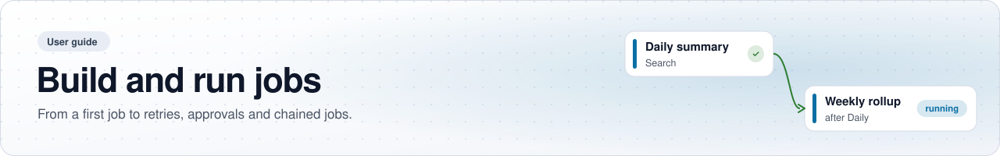
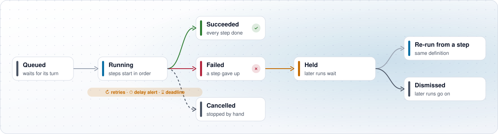
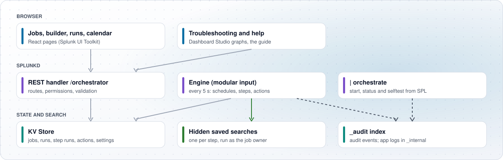

<!-- github-only -->
<p align="center"><picture><source media="(prefers-color-scheme: dark)" srcset="images/header-user-dark.svg"></picture></p>

<p align="center">
  <a href="../README.md"><b>Home</b></a> ·
  <b>User guide</b> ·
  <a href="admin-guide.md"><b>Admin guide</b></a> ·
  <a href="../CHANGELOG.md"><b>Changelog</b></a>
</p>
<!-- /github-only -->

# Search Orchestrator: user guide

Search Orchestrator makes dependent searches run as one unit, so a weekly rollup never runs on top of an unfinished daily summary. Admins: see the [admin guide](admin-guide.md).

<!-- github-only -->
> [!TIP]
> The same guide is built into the app: **Help** in the app bar, with an illustration under every section and **Learn more** links from the pages.

| Get started | Build jobs | Follow runs | How it works and reference |
|---|---|---|---|
| [Words used](#words-used) | [Build a job](#build-a-job) · [Simple, Standard and Advanced](#simple-standard-and-advanced) | [Follow runs](#follow-runs) | [How it works](#how-it-works) |
| [Example jobs](#example-jobs) | [Steps and searches](#steps-and-searches) | [Dependencies](#dependencies) · [Calendar](#calendar) | [Its own scheduler](#its-own-scheduler) · [Search slots](#search-slots) |
| [Help in the app](#help-in-the-app) | [Conditions, tokens and parameters](#conditions-tokens-and-parameters) | [Backfill](#backfill) · [Re-run from a step](#re-run-from-a-step) | [The `\| orchestrate` command](#the--orchestrate-command) |
| | [Triggers and deadlines](#triggers-and-deadlines) · [Notifications](#notifications) | [Troubleshooting](#troubleshooting) | [Audit events](#audit-events) |
<!-- /github-only -->

## Get started

What the words mean, ready-made jobs to start from, and where help is in the app.

### Words used

- **Job:** a graph of search steps, with triggers, parameters and actions.
- **Step:** one search in a job. A step starts only when the steps it depends on have finished.
- **Run:** one launch of a job. Each run keeps a copy of the job as it was when the run started.

You need `orchestrator_build` to create jobs and `orchestrator_run` to start them. Ask your Splunk admin.

### Example jobs

**Browse examples** on the Jobs page (also offered when there are no jobs) shows 6 ready-made jobs that use only data every Splunk has (`_internal`, `_audit`, `| makeresults`, `| rest`): one for each builder view's level.

- **One page, from Simple to Advanced.** Each card says which view it opens in; **Open in builder** opens it there, as a new, unsaved job to look at and save.
- **A picture of each job:** every card draws the job's flow, as on the builder's canvas, so you can see its shape before you open it.
- **Add all examples** saves every one that isn't a job yet, with ids starting `example_`. Existing ones are skipped and errors are listed. To keep just one, open it in the builder and save it.
- **Examples that use other examples** (a Start job action, or After another job) bring those along: Add all examples and Open in builder add them first, so the links point at real jobs. The card says which ("Uses Hourly splunkd errors and Daily, weekly and monthly rollup, added with it").
- Every example is scheduled but **turned off**, and tagged `example` and its view. Turn one on from its Settings when you're ready. Email actions go to `you@example.com` until you change them.

| View | Examples |
|---|---|
| Simple | Hourly splunkd errors: two searches in order, a lookup save, an email when a condition is true and one if it fails |
| Standard | Daily, weekly and monthly rollup · Investigate only when errors were found |
| Advanced | Retries, recovery and clean-up · Chained jobs · Platform health pipeline (everything) |

**Platform health pipeline** is the showcase: four checks in parallel merge into a health score kept in a lookup, with all three kinds of condition, an approval gate, retries, a delay alert, a deadline and a chained job.

### Help in the app

**Help** in the app's navigation bar starts with a visual overview: a quick start in four steps, a drawn example job, the node shapes and line colours of the flow editor, and a card for each feature that jumps to its section. This guide follows, with a contents list beside it. Many fields have a **Learn more** link that opens the matching section.

## Build a job

Open **Jobs**, then **Create job**, or start from an example (see [Example jobs](#example-jobs)). The **Flow** tab shows the job in one of three views (see [Simple, Standard and Advanced](#simple-standard-and-advanced)). In **Advanced**:

1. **Add nodes** with **Add node** or `/`, or drag a line from a node's **+** onto empty canvas.
2. **Connect nodes** by dragging from a node's **+** onto another node. A line between two steps makes the second wait for the first; a line to an action says when it fires.
3. **Select a node** to edit it in the side panel.
4. Use the other tabs for triggers, parameters, who may run and job-wide settings such as the time zone.
5. **Save.**

- **The job is checked as you edit it.** Each tab shows how many problems it has; a failed save lists them, each with **Go to …**.
- **If someone else saved the job after you opened it,** Save asks first: **Reload their version** or **Save mine anyway**.
- Where you put nodes is saved with the job. Moving nodes doesn't count as a change when you re-run a step.

### Simple, Standard and Advanced

<!-- github-only -->
<p align="center"><picture><source media="(prefers-color-scheme: dark)" srcset="images/views-dark.svg"></picture></p>
<!-- /github-only -->

The first tab, **Flow**, has three views of the same job, switched with **Simple**, **Standard** and **Advanced** above it; the tab has the same name in all three. Switching never changes the job. The choice is remembered in this browser for jobs you open; a new job, and a job with no choice yet, opens in **Standard**.

| View | What it shows | Good for |
|---|---|---|
| **Simple** | The searches top to bottom, each starting when the one above succeeds | A chain of searches with a few saves and messages |
| **Standard** | The steps on a canvas with the lines between them; triggers on the **Triggers** tab and each step's actions in its panel | Most jobs: everything Advanced can do, with less on the canvas |
| **Advanced** | Every trigger, step, condition and action as a node | Seeing and wiring the whole job at once |

**Simple is locked** for a job it can't show, such as one with an approval step, more than one trigger or a line that runs on failure. Its button shows a lock; clicking it says why ("Simple can't show this job: an approval step. Use Standard or Advanced.") and keeps the view you are in.

#### Standard

- **The canvas** shows only the steps: searches, saved searches, results of earlier steps, summary index and lookup writes, and approvals. A line between two steps makes the second wait for the first. A line on failure reads **✗ Fails**, either way **∞ Either way**, and a condition reads **◇** and the condition. Click a line to change when it runs or its condition, test the condition, or remove it.
- **Add and connect steps** with a step's **+**, as in Advanced, but it offers steps only (actions are added in the step's panel): click it and pick when (Succeeds, Fails, Finishes either way, If…) and then a step; drag it onto empty canvas to add a step there; or drag it onto another step to connect them. **Add step** above the canvas adds a step on its own. Only kinds your admin hasn't turned off are offered.
- **Small marks on a step** show what is off the canvas: **⚡** a trigger starts it, **✉ 2** it has two actions, **⌛** it has a delay alert.
- **A step's panel** has its settings and, below them, **Actions**: each action with when it fires (Starts, Succeeds, Fails, Finishes either way, Is delayed; on an approval, Approved, Rejected and Asks for approval) and what it does. **Add action** picks when and what; click an action to change its fields and retries, move it, or remove it.
- Whole-job actions are on the **Job actions** tab, as in the other views.
- **Go to** on a problem with one of a step's actions selects the step and opens that action in its panel; on a condition it selects the line. A trigger problem opens the **Triggers** tab.
- **Groups** are drawn in Advanced only: they are frames placed around Advanced's nodes, so Standard leaves them out and keeps them as they are in the job.

#### The Triggers tab

In every view, the **Triggers** tab has a card for each schedule or *after another job* trigger, with the same settings as a trigger node in Advanced (the next run times, the busy-times strip and the quieter-time hint), and **Starts**: the first steps it starts. **Add schedule** and **Add after another job** add one. Trigger problems are counted on this tab. In Advanced, the triggers are also nodes on the canvas.

#### Simple

- **Simple** lists the searches top to bottom. Each starts when the one above succeeds. Click a search to change its name, what it searches (its own data, or the results of the search above), the search and the time range, and to preview it, move it or remove it. **+ Add search** adds one at the end.
- **+ Add…** under a search adds what happens, and when: pick **When this search…** **Succeeds**, **If a condition is true**, **Fails**, **Finishes either way**, **Starts** or **Is delayed** (the same choices as the + in Flow), then **Save to summary index**, **Save to lookup**, **Email** or **Write an event**. Saves are offered only for **Succeeds** and a condition; the others send messages. The items are listed under a heading for each choice.
- **Only if it found results** (on **Succeeds**) sends or saves only when the search returned rows.
- **If a condition is true** has a **Condition** field: a comparison, as on an If… line, such as `$count.resultCount$ > 100`.
- A failed search stops the run.
- **Settings** on a row opens all its fields: an email's subject and message (with **Insert value** for tokens), an event's payload, a summary index's source and run id marker, or a lookup's append. **View output** shows what it wrote.
- **Starts** is the job's schedule, or another job it runs after. **If any step fails** tells someone about any failure in the run. **When done** starts another job, so jobs chain.
- Use **Edit in Advanced** for what Simple can't show.

### The flow editor

Each kind of node has its own shape and colour (a stripe on the left and the icon). Colour never says whether something worked.

| Node | Shape | Colour |
|---|---|---|
| Triggers: **Schedule**, **After another job** | rounded ends | purple |
| **Search**, **Saved search** | rounded corners; a saved search has a second stripe | blue |
| **Results of earlier steps** | cut corners | teal |
| **If…** (a condition) | diamond | amber |
| Notify: **Email**, **Alert action** | notched right edge | pink |
| **Approval** | octagon | amber |
| Write: **Summary index**, **Lookup**, **Event to an index** | cylinder | orange |
| **Start another job** | slanted sides | slate |

**The + handle.** Point at a step (or an **If…** node) to show the round **+** on its right edge.

- **Click +** for the **When** list: what must happen to this node for the next one to run. Pick an outcome, then a node; it is placed to the right and connected.
- **Drag from +** onto another node to connect them (you pick the outcome if more than one fits), or onto empty canvas to add a node there.

| When this node… | Symbol | A line to a step | A line to an action |
|---|---|---|---|
| Succeeds | ✓ | runs it when this step succeeds | fires on success |
| Fails | ✗ | runs it when this step fails | fires on failure |
| Finishes either way | ∞ | runs it whenever this step finishes | fires on complete |
| Starts | ▶ | not allowed (actions only) | fires on start |
| Is delayed | ⏱ | not allowed (actions only) | fires when the step is delayed |
| Asks for approval | ⚑ | not allowed (actions only) | fires when an **Approval** step starts waiting |
| If a condition is true | ◇ | adds an **If…** node; the next step runs when its condition is true (see [Conditions](#conditions)) | not allowed |

- Whole-job actions (it fails, succeeds, is late) are on the **Job actions** tab; see [Actions](#actions).
- Triggers have no +: a dashed line goes from each trigger to the steps it starts.
- An action takes exactly one line in. A line that would make a loop isn't made.
- **Outcome tabs:** each outcome a node uses shows as a small round tab (✓ ✗ ∞ ▶ ⏱ ◇) on its right edge. Its lines leave from there; drag from a tab to add another line with that outcome.
- **Data and signal lines:** a thick line carries data (into **Results of earlier steps**, **Summary index** or **Lookup**); a thin line only says when something runs.

**Line labels.** Lines carry no label; their colour shows the outcome. The selected line shows its label ("✗ Fails", or its condition). **View** → **Line labels** labels every line (hidden below 70 % zoom).

**The line menu.** Click a line, or press `Enter` on it:

- **Change to …** gives the line another outcome; "If a condition is true" turns it into an **If…** node.
- **Insert a node** puts a new step on the line. **Move … onto this line** does the same with a step that has no lines yet.
- **Remove line.** An action's line can't be removed (an action always belongs to something); change its outcome instead.

**Put a node on a line.** Drag a step with no lines onto a line between two steps: A → B becomes A → new step → B, and a message with **Undo** says what changed. A line out of an **If…** node can't be split.

**Toolbar.** On the left: **Add node**, **Arrange** (**Tidy up**, **Group selection**) and **View** (**Node types**, **Grid**, **Line labels**, **Compact nodes**, **Side panel**). On the right: zoom, **Frame all**, **Reset view** and **Full screen** (`Escape` leaves it).

- **Side panel:** hide it with **›**, bring it back with **‹**, drag its left edge to resize it (260–800 px).
- **Node types** opens a legend of shapes, colours and outcomes.
- **The minimap** appears when the graph is bigger than the canvas. Drag the outline in it to move the view.
- **Tidy up** places every node again, as one undo step.
- Dragging near the edge scrolls the canvas. Drag the background to pan; the wheel or the zoom buttons zoom. **Keys:** see [Keyboard shortcuts](#keyboard-shortcuts).

#### Select several nodes

- **Shift+click** adds or removes a node; **Shift+drag** on empty canvas selects with a box; `Ctrl+A` (`Cmd+A`) selects all.
- Drag any selected node to move them all.
- The side panel offers **Align** (left, centres, right, top, middles, bottom), **Distribute** (three or more nodes) and **Tidy up selection**.
- **Remove nodes** (or `Delete`) asks first; **Undo** brings them back.

#### Duplicate, copy and paste

- `Ctrl+D` (`Cmd+D`) duplicates; `Ctrl+C` and `Ctrl+V` copy and paste, also into another job in the same browser.
- Pasted nodes get new ids when an id is taken. Lines between copied nodes come along; lines to other nodes don't.

#### The right-click menu

Right-click a node, a selection or the canvas (or press `Menu` / `Shift+F10`):

- Canvas: **Add node here**, **Paste**, **Tidy up**.
- A node: **Rename**, **Duplicate**, **Copy**, **Save as snippet**, **Preview**, **Add a line**, **Remove**.
- Several nodes: **Duplicate**, **Copy**, **Save as snippet**, **Align…**, **Distribute…**, **Tidy up selection**, **Group**, **Remove nodes**.

#### Snippets

A snippet is a named copy of some nodes that every builder can insert into any job: the nodes, their lines and their searches.

- **Save as snippet** is in the right-click menu and the side panel. Names are up to 80 characters and unique; a snippet holds up to 100 steps and 200 KB. **Everyone who can build jobs can see it, including its searches.**
- **Insert** one from the **Snippets** section of **Add node** (or `/`).
- **Snippets…** in the toolbar lists them; the owner or an admin can **Rename** and **Delete**. Jobs that already use a snippet's nodes keep them.

#### Grid and alignment guides

**View** → **Grid** draws a grid and snaps moved nodes to it. While you drag, guides show when a node lines up with another.

#### Compact nodes

**View** → **Compact nodes** shrinks every node to its name and icon. It changes only how they are drawn.

#### Results on nodes

After **Preview step**, the node shows the result: "1 204 rows · 3.2 s", "Previewing…", "Out of date" or "Preview failed: …".

#### Groups

A group is a coloured frame with a title around some nodes. It never changes how the job runs.

- Select nodes and press `Ctrl+G` (`Cmd+G`), or use **Arrange** → **Group selection** or the right-click menu.
- Select the group to change its title, colour and size (`Shift+arrows`). **Collapse** hides its nodes; dropping a node in its area expands it again.
- **Remove group** keeps the nodes. Groups are drawn in Advanced only.

#### Keyboard shortcuts

With the canvas focused:

| Keys | What they do |
|---|---|
| `Tab` | Move through the nodes, then the lines |
| `Enter` | Select the focused node or line; open a line's menu |
| `+` or `Shift+Enter` | Open the When list of the focused node |
| `/` | Open the add-node box |
| `Shift+Space` | Add the focused node to the selection or take it out |
| `Ctrl+A` / `Cmd+A` | Select every node |
| `Ctrl+C`, `Ctrl+V`, `Ctrl+D` (`Cmd` on a Mac) | Copy, paste, duplicate |
| `Ctrl+G` / `Cmd+G` | Group the selected nodes |
| `Delete` or `Backspace` | Remove the selection, after you confirm |
| Arrow keys | Move the selection by 10 px |
| `Shift+arrows` | Resize the selected group |
| `F` | Frame the whole graph |
| `Menu` or `Shift+F10` | Open the right-click menu |
| `Escape` | Close a list or menu, clear the selection, leave full screen |

### Previewing steps

**Preview step** runs one step now and shows its rows, without saving the job. Nothing goes into the run history and no actions run.

- **Who:** you need `orchestrator_build` or `orchestrator_admin` and the right to edit the job. A preview runs **as you**; a real run uses the job owner's access.
- **Preview as if scheduled at:** the time the step's time range and **Run when** are worked out from (by default the schedule's last time).
- **Parameters:** one input each; empty uses the default.
- **Input from:** where earlier steps' results come from:
  - **Live previews** (default): your previews in this editor. Earlier steps without a current preview are previewed first, in order, following the lines as a run would.
  - **A past run:** that run's saved results, times and parameters (one of the job's 20 newest runs). Expired results fail the preview; it never falls back to live.
- **Result:** the row count, time and which earlier steps it read, then the first 100 rows. Search errors and warnings show above the table; an ERROR fails the preview, as in a run.
- **Previews never write.** **Summary index** and **Lookup** steps, and searches with `collect`, `outputlookup`, `outputcsv`, `tscollect`, `mcollect`, `meventcollect`, `sendemail` or `delete`, can't be previewed; the button says why. Saved searches and macros aren't expanded, so check those yourself.
- **Skipped steps:** "Would be skipped" says why; **Preview anyway** runs it once.
- **Out of date:** changing the step, time, parameters or input greys out its preview and the ones after it.
- **Limits:** a preview stops after the step's max runtime (at most 10 minutes), or about 3 minutes after you stop watching it, and is kept 30 minutes. Each step has one preview at a time; **Cancel** stops it.

### Job source

The **Source** tab, after Settings, shows the job as JSON text, so you can copy it, keep it in a file or paste it into another Splunk. Server fields (owner, created and updated details, hidden searches) are left out. Keys, strings, numbers and the SPL inside each `spl` value are coloured, in light and dark themes.

- **Copy** puts the text on the clipboard. If your browser blocks that, the text is selected and the tab says "Press Ctrl+C to copy".
- **Download** saves it as `<job id>.json` (`new-job.json` for a job that isn't saved yet).
- Edit the text, then choose **Apply changes**. The whole job is replaced as one step, so **Undo** brings the previous job back. Problems with the new job show in the issue list and on the tabs as usual. Syntax errors say where: "The source isn't valid JSON: ... (line 3, column 7)". The text must be a job object with `name` and `steps`.
- **Discard changes** puts back the text of the current job. If the job changes while you have unapplied edits (for example after Undo), your text is kept and the tab asks you to discard to see the latest.
- **The id is kept.** An `id` in the pasted text is ignored; the job keeps its own id, and the tab tells you so.
- If you can view a job but not edit it, the text is read only and only Copy and Download show.

Switching to another tab drops unapplied edits, so apply or copy them first.

To bring a job in from text, choose **Import jobs** on the Jobs page, paste the JSON or choose a `.json` file, and choose **Open in builder**. The job opens as a new, unsaved job (its id and server fields are dropped); choose **Save** to create it.

### Export and import many jobs

To move jobs to another Splunk, or keep a copy, choose **Export all jobs** on the Jobs page (with **Find jobs** or **Show** narrowing the list, it says **Export N shown** and exports only those). For one job, choose **Export** in its **⋯** menu; that downloads `search_orchestrator_job_<id>_<date>.json`. Exporting many downloads `search_orchestrator_jobs_<date>.json`: each job's definition with its id, without owners, run history or other server fields.

To bring them in, choose **Import jobs** and paste the file or choose it. The dialog lists the jobs in it and saves them at once with **Import N jobs**:

- **Ids are kept**, so Start job actions and After another job triggers between the jobs still point at each other.
- **Nothing is replaced.** A job whose id is already taken is skipped, and the dialog names it.
- **Turn the imported jobs off** is ticked by default, so none runs before you have checked it. Turn each on in the Jobs list.
- You become the owner of each job you import. A job that fails its checks is not imported, and the dialog says why.

A single job (or a file with one job that isn't an export file) still opens in the builder, as above.

### History

The **History** tab, the last tab in the builder after Source, lists every saved version of the job, newest first. Each save that changes the job adds a version, with who saved it, when, and up to eight short lines about what changed ("Changed the search of daily", "Added a line from a to b"). A job saved before 1.19.0 starts with "Saved before version history started" the first time a save changes it; saving it unchanged adds nothing. The newest 50 versions are kept.

- **Compare with current** shows what changed between that version and the job as it is now. To compare two versions, select both and choose **Compare selected**.
- **Restore** saves that version as a new version, after you confirm in **Restore version N?**. Nothing is deleted, and the job's history shows "Restored from version N". It is hidden on the newest version. You need the right to edit the job. Unsaved changes in the builder are lost, and the dialog says so. If you are an admin and not the owner, you become the owner, as with any save.
- Anyone who may see the job may read its history. A new job has none until you save it. Deleting a job deletes its history.

## Steps and searches

What a step can do: run a search, read earlier steps, write results, or wait for a person.

### Steps

- **Search** steps hold SPL. **Saved search** steps run an existing saved search. **Results of earlier steps** steps search the results of the steps before them; see [Results of earlier steps](#results-of-earlier-steps).
- **Steps run as the job owner**, with the owner's roles and index access.
- **A saved search must be shared globally or saved in this app** to be a step; saving says so otherwise. Unless it is your own private search, its own alerts and summary indexing don't run (add `collect` if you need them).
- **Time range:** a preset (the hour, day, week or month before, the last 24 hours), **All time** (with a warning) or **Custom** (Splunk relative times such as `-1d@d` and `@d`). Times are relative to the run's **scheduled time**, so a daily summary that starts late still covers the right day. The builder shows the window searched. A new step searches **The 24 hours before**.
- **Run when:** limits a step to some days (**Days of week**, or **1st of month**), so one job can hold daily, weekly and monthly steps. A step that doesn't apply shows *Skipped (run when)* and lets the steps after it go ahead.
- **Delayed after** (default 1 hour from the scheduled time) fires the delay alert once.
- **Give up after** (default 24 hours): the step fails, and the run's other searches are cancelled.
- **Max runtime** (default 4 hours per attempt).
- **Events scanned limit:** how many events the search may scan; empty uses the limit in Settings, if any. Over it, the search is stopped or finishes with a warning, as Settings says.
- **Retries** (default 0). A retry runs the search again, which can write duplicates; see [Make steps safe to re-run](#make-steps-safe-to-re-run). Searches that never started are always retried up to 3 times.

### Writing the search

The **Search** field colours your SPL as you type, in the light or dark theme: commands and pipes in the accent colour, keywords (`by`, `as`, `AND`, `OR`), functions, fields before `=`, strings, `$tokens$`, `` `macros` ``, ``` ``` comments ``` ``` and numbers each get their own colour. The colours only help you read; the search is saved exactly as typed.

Typing `|` puts it on a new line, as `| ` at the start of the line, so a pipeline reads one command per line. A space just before the pipe is dropped. It does nothing inside a double-quoted string or a ```` ``` ```` comment, for `||`, or on a line with nothing before it, and pasted text is never changed. Ctrl+Z (Cmd+Z on a Mac) undoes the new line in one step. Clear **Put each | on a new line** under the field to type pipes in place; the browser remembers the choice.

### Results of earlier steps

A **Results of earlier steps** step searches the results of the steps it depends on, with no search of its own to repeat. Its SPL runs on their rows, as if each were loaded with `| loadjob`: the first dependency's results, then each later one appended, in the order the dependencies were connected.

- **Its SPL must start with `|`**, such as `| stats sum(count) by host`. Saving fails otherwise, and it fails unless the step depends on at least one step (a connection into it).
- **It has no time range of its own.** It works on rows the earlier steps already found. Switching a step to this type drops its Earliest and Latest.
- **Switching back to Search** writes the input into the SPL as `| loadjob $<step>.sid$` tokens. A token from a skipped or failed step fails the step, so if a dependency can be skipped or fail, give the token a default or keep the Results of earlier steps type.
- **Skipped and failed inputs add nothing.** Only dependencies that succeeded are loaded. A step that runs after an `on_failure` connection still runs, without the failed step's rows. If no dependency succeeded, it runs on no rows.
- **The second and later inputs are limited to 50,000 rows each.** They are appended through a subsearch, and Splunk cuts a subsearch short at that limit. When that happens the step fails with "a subsearch was cut short: ..." and Splunk's message, never with silently partial results. The first input has no such limit, so connect the largest dependency first, or summarise the inputs before they reach this step.

### Write results to an index or a lookup

**Summary index** and **Lookup** steps write the results of the steps before them. Draw a thick line from the step whose results you want, then select the node.

- **Summary index:** the index, an optional **Source**, and **Add the run id** (on by default), giving for example `| collect index=summary source="daily" marker="so_run=$run.id$"`. The marker says which run wrote each event.
- **Lookup:** a lookup file such as `hosts.csv`, or a lookup definition, and **Append instead of replace**: `| outputlookup append=true hosts.csv`. Without append, each run replaces the lookup.
- **What is written:**

  | Setting | Summary index step | Lookup step | Event action |
  |---|---|---|---|
  | Source | yes (default: the step's search) | — | yes (default: the action's search) |
  | Sourcetype | yes (default `stash`) | — | yes (default `stash`) |
  | Host | yes (default: this search head) | — | yes |
  | Content | **Fields to write** (empty: every field) | **Fields to write**, in column order | **Event** text, with tokens |
  | Timestamp | each result's `_time`, the run's scheduled time, or when it writes | — | when the action runs, or the run's scheduled time |

  A sourcetype other than `stash` counts against your Splunk license.
- **View output** shows what was written: a lookup's contents, a summary index's or event action's events (last 24 hours, 7 or 30 days), or for an email, splunkd's sendemail lines. Up to 100 rows, with **Open in Search** for the rest. On the run page, **Output** shows only that run's events. It searches as you.
- The generated **Search** can't be edited; **Edit as search** turns the node into a plain **Results of earlier steps** step you can change.

### Approval steps

Approval is in **Beta**: still in development, so it may not work yet. An admin can turn it off in **Settings > Building blocks**.

An **Approval** node (an octagon) makes a run wait for a person. It runs no search. Connect it like a step; lines out of it use its own outcomes:

| Outcome | Meaning |
|---|---|
| Approved | someone (or the timeout) approved; the steps after it run |
| Rejected | someone (or the timeout) rejected; the step fails and is never retried |
| Decided either way | after either decision |
| Starts, Is delayed | as for a step |
| Asks for approval | actions only: when it starts waiting, for example an email to the approvers |

Its fields:

- **Message** for the approvers (up to 500 characters, with tokens), also in the default email.
- **Who may approve:** roles. Their members who also hold `orchestrator_approve` can decide; admins always can. Empty means anyone who may approve runs of the job; then the run's starter may decide too.
- **Wait at most** (5 minutes to 7 days) and **If nobody decides** (**Reject**, the default, or **Approve**).

While it waits, the step says "Waiting for approval", and people who may decide see **Approve** and **Reject** in its details (a comment is required to reject).

- A paused run never times out, but paused time counts toward the wait.
- A re-run from the approval, or from before it, asks again.
- Previews treat an approval as approved.

## Conditions, tokens and parameters

How a job decides what runs next, and how values move between steps.

### Conditions

An **If…** node (or a line set to **If a condition is true**) runs the next step only when its condition is true. **Check with** picks how it is written:

| Check with | Write | True when |
|---|---|---|
| **Simple comparison** (default) | `$daily.resultCount$ > 0 and $run.param.region$ == 'eu'`: tokens, numbers and quoted strings with `==`, `!=`, `>`, `>=`, `<`, `<=`, `and`, `or`, `not` | the comparison holds |
| **SPL expression** | what you would write after `\| where`, with any eval function | `\| makeresults \| where <expression>` returns a row |
| **Search returns results** | a full search, like an alert's | the search returns at least one row |

The condition field is the same SPL editor as a step's search, with **Insert value** and **Open larger**.

Examples:

- `$daily.resultCount$ > 1000 AND tonumber(strftime(now(), "%w")) = 1`: more than 1000 rows, on a Monday.
- `match("$daily.first.status$", "^(ok|done)$")`
- Search returns results: `| loadjob $daily.sid$ | where count > 0 | head 1`

How SPL conditions run:

- **When the line's source finishes**, as the job owner, through a hidden saved search, **once per run**. The next step shows *Waiting* meanwhile. A skipped source never runs it.
- **Time** is relative to the run's scheduled time, as in steps: `relative_time(now(), "@d")` is the scheduled day. `$run.now$` is the clock time. **Search returns results** has its own **Time range**.
- **Tokens** go in as quoted strings. In an SPL expression the number tokens (`resultCount`, `scheduled_time`, `now`) are numbers; wrap first-row and parameter values in `tonumber()` to compare them as numbers.
- **Single quotes** name fields in SPL, so a token can't follow an unclosed `'`. Put text with an apostrophe in double quotes.
- **A condition only reads:** no `collect`, `outputlookup`, `sendemail`, `delete`, `| orchestrate` and the like. An SPL expression can't contain `|` outside quotes.
- **A condition that fails counts as not met:** a search error, a token with no value, a subsearch cut short, or more than **300 seconds**. The next step is skipped, and the run page shows why.
- **One line per pair of steps** can carry a condition. Conditions count toward the search limits; previews treat an SPL condition as met.

#### Test condition

**Test condition**, under the condition field, runs that one condition now, with the same input, time and parameters as **Preview step**. It shows **True** or **False**, why (each token's value, or the row count) and the filled search. It runs as you and never takes part in a run. If the source step has no current preview, it offers to preview it first.

### Tokens

Use these in SPL, expressions and action messages:

- `$run.id$`, `$run.scheduled_time$`, `$run.param.<name>$`
- `$run.now$`: the time, in epoch seconds, when the value is filled in: when a step's or condition's search starts, when an action's hook fires, or when a simple condition or run-when expression is checked. `$run.scheduled_time$` is when the run was scheduled.
- `$<step>.sid$`, `$<step>.resultCount$`, `$<step>.status$`
- `$<step>.first.<field>$`: a field from the step's first result row

**Insert value** next to a search, a condition or an action message (the email subject and message, and the event payload) lists the tokens that exist at that point and puts the one you pick at the cursor. A selection is replaced. With no cursor in the field, the token goes at the end.

**Tokens are substituted as quoted values**, so they can't be used to inject SPL commands or field names.

- `index=$run.param.idx$` runs as `index="<value>"`; a token you already put inside double quotes stays there.
- A token can't sit inside a ```` ``` ```` comment or right after a backslash (put the backslash in the value). A parameter or result value containing a backtick fails the step.
- Pass a step's full results with `| loadjob $daily.sid$`, so nothing runs twice.
- A step can't call `| orchestrate`; use a start-job action instead.
- Any other `$` text in SPL, such as `rex "foo$"`, is left alone.
- A token from a skipped step fails the step that uses it, unless you give a default: `$weekly.sid|none$`.

### Parameters

Declare each parameter with a type (string, number, enum or time) and an optional pattern. Values are checked when a run starts, and every value goes into SPL as one escaped, quoted string.

- A value is at most 4,096 characters, and a pattern at most 500. A pattern that repeats a group which already repeats, such as `(a+)+`, can't be saved, because matching it can take minutes.
- **`*` is still a wildcard.** In `user="$run.param.u$"`, the value `*` matches every user. If the people who may run the job must not widen the search, give the parameter a pattern such as `^[a-z0-9_.-]+$`, or make it a list.

## Triggers and deadlines

What starts a job, who may start it, when it must be done, and what happens when a step gives up.

### Triggers

| Trigger | How |
|---|---|
| Schedule | A **Schedule** node (or a card on the **Triggers** tab), in the job's time zone. |
| Manual | **Run now** on the Jobs page. |
| Search | `\| orchestrate start job=<id> param.<name>=<value>` |
| Alert | The "Start orchestrator job" alert action. The alert must be owned by a real user who may run the job, not `nobody`. |
| REST | `POST /services/orchestrator/jobs/<id>/runs` |
| Job completion | "After job X succeeds" or "completes" (also when X is cancelled). |

**Schedules**

- Pick **Hourly**, **Daily**, **Weekly**, **Monthly** or **Custom** (a cron expression). A job can have more than one.
- The editor says when it runs ("Every day at 01:00") and lists the next times. It warns when other jobs start in the same minute: they compete for search slots, so move one a few minutes.
- **Busy times** under the schedule shows the other jobs' load over the next day (or week) and may suggest a quieter start. It is only a hint.
- **Time zone** is on the Settings tab; empty uses the server's.
- **Missed runs:** if the engine was down at a scheduled time, run each missed time (up to 7), only the latest, or none.

**Which steps a trigger starts.** A trigger starts only the steps it has a line to, so one job can run some searches hourly and others daily.

- Connect a trigger with its **+**, or remove a line from it with **Remove line**.
- Steps the trigger doesn't start are skipped ("not started by this trigger"), with their branch.
- Two schedules firing in the same minute make one run with both sets of steps.
- **Run now**, `| orchestrate start`, alerts, REST and backfills start every first step.

**After another job**

- You can follow only a job you may see; a hidden job never starts yours.
- Each upstream run starts the downstream job once, with the upstream run's scheduled time.

### Deadline

On the job Settings tab, the **Finish by** and **Finish within** fields set when a run must be finished. Fill in either one or both:

- **Finish by**: a time of day such as `06:00`, in the job's time zone. It means the first 06:00 at or after the run's scheduled time.
- **Finish within**: a time after the scheduled time (1 minute to 7 days).

A **Finish by** that isn't a time like `06:00` is shown in red and the job can't be saved until you fix or clear it.

With both, the earlier one counts. The deadline is wall-clock time, so pausing a run does not move it. A time that does not exist on a daylight-saving day becomes the first moment after the gap.

**Only on-time scheduled runs, and runs started by another job's run that had a deadline itself** (completion or start-job triggers, along a chain of any length), have a deadline. Manual, REST, alert, backfill and catch-up runs have none, because they are often scheduled in the past and would be late at once, and neither do the runs they start. A deadline is fixed when the run is created and a re-run keeps it. A re-run of a run that finished before its deadline, started after the deadline, is not late.

When a run that has not finished passes its deadline, it is marked late once. A job action with **When: The job misses its deadline** (on the **Job actions** tab) fires then. If a job has no late action, your admin's fallback notification is used. The run's page shows "This run missed its deadline (...)" with how late it finished, or that it is still running, and the audit index gets `run_late`. Late runs do not change the run's outcome. **Run health** lists them under **Late runs**.

### Who may run

On the Access tab, list roles that may start the job. **Their runs search as you, with your access**, but only the SPL you saved. Role names you type are not checked, so check the spelling.

If you lose every orchestrator role, nothing of yours runs any more, whoever starts it: each step fails and says why, until you get a role back or an admin takes the job over.

### When a step gives up

On the job Settings tab:

- **Wait for this run to be fixed** (default): later runs wait until someone re-runs or dismisses the failed run. A rollup can't run over a window with a missing day.
  While runs are held, runs turned away because the job's queue is full are reported in the daily hold alert, not one notification each.
- **Start later runs anyway:** later runs go ahead, so a weekly rollup may run with a day missing.

This setting is read from the job **as it is now**, not from the run's copy. Changing it affects runs already waiting.

## Notifications

How a job tells people what happened.

### Actions

There are two kinds of action:

- **A step's actions** are nodes on the Flow tab. Drag a line to one from the step's **+** handle; the line's outcome says when it fires (Starts, Succeeds, Fails, Finishes either way or Is delayed). An action's **When** field moves its line, to another step or outcome, from the keyboard.
- **The whole job's actions** are on the **Job actions** tab, next to Flow: **Add job action**, then pick **When** (the job fails, succeeds, finishes either way, starts, a step is delayed, or the job misses its deadline) and what it does. They fire once for the whole run.

- **Email**, **event to an index**, **start another job**, or **any installed alert action**. Pick the alert action from the list, which shows the enabled custom alert actions this app can use. Built-in actions such as email can't run this way. Its parameters then appear as labelled fields, taken from the form the action shows in Splunk's alert editor. A field left empty uses the action's own default. **Other parameters** takes anything the form doesn't list, one `name=value` per line; an action with no form or settings has only this box.

Action messages (email subject and message, event payload and alert action parameters) take the tokens above, filled in when the action is sent, for example an email subject of `Daily rows: $daily.resultCount$`. A token with no value uses its default (`$weekly.sid|none$`) or is left empty. They also take `{{job}}`, `{{run_id}}`, `{{hook}}`, `{{step}}`, `{{status}}`, `{{run_url}}` and `{{message}}` (the default message). Values sent to email, event and alert actions are escaped.

**Retries.** When sending fails for a reason that may pass (a mail server that is down), an action is tried again: 3 times by default, waiting 30 s, then 1 and 2 minutes. An action's **Retries** (0 to 10) and **First wait** (10 seconds to 1 hour, doubling each time, at most an hour) change that; the panel spells out the waits. Errors that won't go away, such as a missing alert action, fail at once.

An action failing never changes the run's outcome; it shows on the run's Actions tab. If a job has no failure or delay action, your admin's fallback notification is used.

### Slack, Teams, PagerDuty and ServiceNow

Use an **Alert action** and pick the one the service's own Splunk app adds (such as the Slack, Microsoft Teams and ServiceNow add-ons on Splunkbase). It gets the same fields as in Splunk's alert editor.

Webhook, Slack, Teams, PagerDuty and ServiceNow actions were removed in 1.50.1. A job that still has one drops it when you open it in the builder, with a note: save to keep the change. Until it is saved, the engine skips that action and sends the fallback notification instead.

### Follow a job

Choose **Follow…** in a job's **⋯** menu to be told about it without changing the job; anyone who can see the job may follow it.

- **Tell me when:** it fails, it misses its deadline, a step is delayed, or it succeeds.
- **How:** an email to the address on your own Splunk account.
- The message names the job, what happened and links to the run; it never carries results.
- A bell next to the name shows the jobs you follow. **Following…** in the same menu changes what you are told, or **Unfollow** stops it.
- If you can no longer see the job, or your account has no email address, nothing is sent and the run's Actions tab says why.

## Follow runs

<!-- github-only -->
<p align="center"><picture><source media="(prefers-color-scheme: dark)" srcset="images/run-lifecycle-dark.svg"></picture></p>
<!-- /github-only -->

- **Jobs** lists every job you may see; see [The Jobs page](#the-jobs-page).
- **Runs** lists the runs, grouped by job, with a progress bar on active runs; see [The Runs page](#the-runs-page).
- **Runs → Timeline** puts every job's past, running and scheduled runs on one time axis, over 24 hours or 7 days. Above them, **Concurrent searches** shows this app's searches against its own limit, and **All Splunk searches** every search on the search head against Splunk's limit (it needs `_audit` and `_internal`, which by default only admins have); see [Search slots](#search-slots). Jobs you may not see show as **Hidden job N**.
- **Dependencies** and **Calendar** show how jobs start each other and when they run.
- **A run's page** has a timeline, the graph, logs, actions, performance, parameters and **Compare**. A line under the header says what to do next when the run needs you; **Dismiss run** lets later runs start past a failed one. Click a step for its attempts, actions and search job.

**Waiting for approval.** While a step waits for approval, every page shows a banner with **Review**.

**Why it waits.** A **Queued** run says why: another run of the job is running, earlier queued runs go first, a failed run holds the job, or the engine isn't running. A step that hasn't started says what it waits for: earlier steps, or the search limits in Settings.

| Run state | Meaning |
|---|---|
| Queued | Waiting behind an earlier run of the same job. Runs of a job never overlap. |
| Running | Steps are running or waiting on dependencies. |
| Blocked | A step failed with nothing to handle it. The run waits for a re-run, cancel or its deadline. |
| Paused | No new steps start; running searches carry on. |
| Succeeded, Failed, Cancelled | Finished. |

**Delayed** isn't a state: the work is still expected to finish. A step a branch didn't reach shows as *Skipped (branch not taken)*.

### The Jobs page

Each row shows:

- **Name** with a summary (when it runs, how many steps), its **tags** (click one to show only those jobs), a bell when you follow it, and **warnings**: a Start job action to a job that doesn't exist or is disabled, an After another job trigger that follows a missing job, and steps a re-save fixes. The builder shows the same warnings when you save.
- **Next run** and how soon ("in 6 min"). More than about 400 days away shows as a dash.
- **Last runs:** the last run, and the 10 newest as status icons (oldest left; hover for the state and time, click to open). "N of the last 10 failed" when some did.
- **Duration:** the last run's time (or "so far") and **usually**, the median of the recent runs that succeeded (at least 3). At least twice the usual time and 30 seconds more is marked: "3.6× the usual 55s".
- **Run now**, an enable switch (it never changes the owner), and **⋯** with Edit, Follow…, Backfill… and Delete… (cancel a job's active or queued runs before deleting it).

Above the table:

- **Find jobs** searches names, ids, owners, descriptions and tags.
- **Show** narrows to jobs whose last run failed, jobs with warnings, disabled, scheduled or your own; **Tag** to one tag; **Sort by** orders by name, next run, last run or failed first. All are remembered in this browser, so while any of them hides jobs a line says so ("Showing 3 of 12 jobs: tagged billing") with **Show all jobs**.
- **Tick boxes** pick jobs for **Run now**, **Enable**, **Disable**, **Export**, **Add tag** and **Delete**. Jobs an action doesn't apply to are skipped, and a message says what was done, skipped and failed.
- **Export** downloads the jobs shown, and **⋯ > Export** downloads one job; see [Export and import many jobs](#export-and-import-many-jobs). **Create job**, **Import jobs** and **Browse examples** are at the top of the page.

### Tags

Give a job up to 10 tags (team, system, environment) in the builder's **Settings** tab: type a tag and press `Enter`, or pick one other jobs use. Tags are 1 to 40 letters, digits, spaces, `_`, `.` or `-`, and matching ignores case. The Jobs, Runs and Calendar pages have a **Tag** filter, and a run started before a tag change is still found by its job's tags now.

### The Runs page

- **Grouped by job:** one row per job with its latest run, how many runs are in each state and **⚑ N waiting for approval** when a step waits. Click the job to open its runs, or **Only this job** to filter. **Show: All runs** gives one list, newest first (remembered in this browser).
- **Filters:** job, tag and state. **Needs attention** shows blocked and failed runs, runs that hold later runs back, and running or paused runs with a step waiting for approval.
- **Run #N** is each run's number within its job (1 for the oldest kept run), the same in every filter.
- **Many runs at once:** tick runs (a job's row ticks all its runs; the header box ticks every run listed). A bar above the table offers what applies, with how many:
  - **Cancel:** queued, running, paused or blocked runs.
  - **Re-run:** failed, blocked or cancelled runs, each from its first failed step with the job as it was when the run started.
  - **Approve** and **Reject:** runs waiting for an approval, if you may approve. Reject needs a comment.
  - A dialog lists the runs first. Each run is checked as if you changed it on its own, and a message names any run that wasn't changed, and why.

### Compare two runs

The **Compare** tab on a run puts it next to another run of the same job: by default the newest finished run before it, or any of the job's last 50 runs.

- A line says how each run ended and how long it took, whether the job changed between them, and which parameters differ.
- A table has one row per step: its state, run time, results and events scanned in each run, and **What changed** in words: "succeeded → failed", "2.5× slower", "1 204 → 0 results", "5× the events scanned", "search changed", "new step". Changes for the worse are marked.

### Performance

The **Performance** tab on the run page has one row per step with **Step**, **Runtime**, **Events scanned**, **Results** and **Disk**, and a **Total** row. The engine stores these numbers on each step and attempt when the search finishes, so runs from before 1.23.0 have none until you load them.

**Peak CPU** and **Peak memory** aren't loaded with the page. **Load CPU and memory** reads them from `_introspection` as you, within 30 seconds and for at most 50 searches. It also fills the other columns for steps from before 1.23.0 from `_audit`, when you may search it. If you can't read `_introspection`, the tab says so and the other columns still show. See also the Performance section of Run health, below.

### The run graph

The **Graph** tab on a run shows the job as you built it, with each step's state and each action's result. Click a step for its details. A strip above shows the run's state, how long it has run and how many steps are finished; an active run updates every 5 seconds.

While the run is active:

- **Running steps** pulse, with a spinner and a timer.
- **Lines** that fired are solid in their outcome's colour; a line into a running step flows; a line that won't fire is thin and faded.
- **Finished steps** show their outcome and time; **waiting** steps say what they wait for; skipped steps say why.
- The graph **follows** the running steps until you pan or zoom; **Follow the run** turns it back on.
- With reduced motion on, nothing moves; colours, timers and text stay.

| Action text | Meaning |
|---|---|
| Sent | The action ran and succeeded. |
| Failed | The action gave up; the run's outcome doesn't change. |
| Sending… | An attempt is under way. |
| Retrying in 30 s | The next attempt starts in the time shown. |
| Not sent yet | The step or job hasn't reached the action. |

## Dependencies

**Dependencies**, after Runs in the navigation, shows how jobs start each other. Each job you can see is a node with its owner, its last run's state and how long ago it ran ("Turned off" and "Never run" are shown too). A line goes from the job that starts another to the job that is started. Its label says why:

- **after it succeeds** or **after it finishes**: a completion trigger on the started job.
- **start-job action · <outcome>**: a start-job action on the starting job, such as "start-job action · Succeeds". An action on a step adds the step's name: "start-job action · <step> · Succeeds".

A job you aren't allowed to see appears as **Job you can't see**, so a chain stays whole without showing its name; it has no links.

- **Select a job** by clicking it, or Tab to it and press Enter. A panel under the graph lists **Started by** and **Starts**, with **Open job** (the builder) and **Open runs** (the Runs page for that job). Arrow keys pan the graph; **Zoom in**, **Zoom out** and **Reset view** change the view.
- **Not connected** lists the jobs with no completion trigger or start-job action, as buttons that select the job and show its panel.
- **List** (next to **Graph**) shows the same as a table of **Job**, **Started by** and **Starts**, for screen readers and keyboard users.
- The page refreshes every 30 seconds.

## Calendar

**Calendar**, after Dependencies, shows when jobs run, by **Day**, **Week** or **Month** (weeks start on Monday), in your browser's time zone.

- **‹ Previous**, **Next ›**, **Today** and **Go to date** move around (also `←`, `→` and `T`). **Job** and **Tag** narrow it.
- **Scheduled** times have a dashed border; **runs** show their state with an icon, and **Late** if they missed a deadline; **Backfill · <job>** marks a backfill time not yet started.
- **Month** lists up to three jobs a day with a dot for the worst state that day; click a day to open it. More than three items in half an hour collapse into **+N more**.
- Click an item to open its run, or the job.

It shows at most 300 scheduled times per job and 2,000 items in all (pick one job to see more), only for jobs you may see, and refreshes every minute while it shows today.

## Backfill

A backfill runs a job once for each time in a past range, oldest first, for example to fill in a month of a daily rollup. Choose **Backfill…** in a job's **⋯** menu on the Jobs page, or in the builder toolbar.

- **From** and **To** (your browser's time zone; To is not included).
- **Runs at**: **The job's schedule** (each time its enabled schedules would have fired) or **Every …** with a step from 1 minute to 31 days, counted from the start of the range.
- **Runs in the queue at once** (1 to 5): how many of the backfill's runs wait in the job's queue together. Runs of one job never overlap, so more only keeps more of them waiting.
- Parameter values the job declares are filled in the same way for every run.

The dialog counts the runs before you start. A backfill can hold up to 100 runs over at most 400 days; narrow the range or lengthen the step if it is too big. Each run's scheduled time is its time in the range, so steps summarise that period's window. Backfill runs have no deadline, and neither do the runs they start through completion triggers or start-job actions.

On the **Runs** page, a backfill shows as a line with its progress ("Backfill of 30 runs: 12 finished, 1 running, 17 to go.") and **Cancel backfill**.

- Cancelling stops feeding runs and cancels the ones that have not finished, as a group, after you confirm.
- Starting a backfill needs the right to run the job. Cancelling needs you to be its creator, to be allowed to edit the job, or to be an admin.
- Deleting the job cancels its running backfill, so a new job with the same ID never picks it up.

## Re-run from a step

On a blocked, failed or cancelled run, choose **Re-run from step**. That step and everything after it run again with the same scheduled time and parameters; finished steps before it are kept.

- If the job changed since the run started, **you must choose the latest or the original definition**. Nothing is preselected. The latest is disabled, with the reason, if it removed a step the run needs. The search command needs `definition=latest` or `definition=original` in the same case.
- Tick **start downstream jobs again** to re-fire completion triggers that already fired.
- Step results are kept for 24 hours after a run by default. If they have expired, the step fails and says which earlier step to re-run.

### Make steps safe to re-run

Retries and re-runs run a search again. If the search writes with `collect` or summary indexing, it can write the same data twice. The app doesn't detect or remove duplicates. Ways to stay safe:

- **Overwrite instead of append.** Write to a lookup with `outputlookup`, or to KV Store with a key per time window, so a second write replaces the first.
- **De-duplicate when reading.** Summarise per time bucket and read with `dedup _time` or `stats latest(...) by _time`.
- **Check first.** Have the step look for existing summary data for its window and write only if there is none.
- Keep **Retries** at 0 for steps that write.

## Troubleshooting

**Troubleshooting** in the navigation bar explains what the app did and why, from its own log lines: the engine (schedules, runs, searches, conditions, actions, approvals, backfills) and the pages and API (every change and failed request).

- **Health:** single values for the engine (running, last tick), errors, warnings, failed requests, response time, failed actions, skipped schedules and failed runs. Click one to show those lines.
- **Graphs**, a tab each: **Activity**, **Requests**, **Engine**, **Splunk calls** (Debug level only) and **Events**. The magnifying glass under a graph opens its search in Search.
- **What happened:** every line in words, such as "Email failed after 3 tries: mail server refused the connection", with the job, run and step by name. Expand a line for **Why**, **What to do**, every field and the raw line.
- **Problems:** errors and warnings grouped by what went wrong, most serious first, with how often, which jobs and when last seen.
- **Run story:** pick a run to read it from created to finished, with the waits explained ("queued: waiting for its turn", "waiting for someone to approve").
- **Why a job did not start** is always in the lines: the job was disabled, the engine was stopped (and what **Missed runs** did), the run waited in the queue or for a search slot, or the job it waits on wasn't started.
- **Filters:** time (15 minutes to 7 days), job, level, part, text and run. They are kept in the address, so you can share the view. **Live** refreshes every 10 seconds. **App logs** on a run or step opens the page filtered to it.
- **Log level** in Settings: **Errors only**, **Warnings and errors**, **Info** (default) or **Debug** (also every read, tick and splunkd call). A change applies within 30 seconds.

Colours are the same everywhere on the page (red errors, orange warnings, blue info, green OK, grey detail), always with an icon and a word.

### App health alerts

The app ships three Splunk alerts, **off** until an admin turns them on (**Settings > Health > Turn the alerts on or off**, or Splunk's **Settings > Searches, reports, and alerts**, then **Edit > Enable**):

| Alert | Fires when | Checks |
|---|---|---|
| Search Orchestrator - Engine not running | no engine heartbeat for 15 minutes | every 5 minutes |
| Search Orchestrator - Missed schedules | scheduled runs never started (`schedule_missed`) | every 15 minutes |
| Search Orchestrator - Errors | the app logged an error | every 15 minutes |

Once on, each adds a Triggered Alert (**Activity > Triggered Alerts**, or **Triggered alerts** in Settings > Health), at most once an hour for the engine and errors. To be told by email, Slack or another way, edit the alert and add an action. They search the app's own log lines in `_internal`.

**Search the lines yourself.**

- They live in `_internal`, one file per process: `search_orchestrator.engine.log` and `search_orchestrator.rest.log` in `$SPLUNK_HOME/var/log/splunk`.
- Each is `key=value` fields: `level`, `process`, `event`, `run_id`, `job_id`, `step_id`, `user`, `ms` and more.
- Example: `index=_internal source="*search_orchestrator.*.log" run_id="daily:1764547200"`. Inside the app, the `orchestrator_logs` macro gives the first part.
- Reading them needs read access to `_internal`, which admins have. They never hold passwords, tokens or search results.

### Run health

**Run health** in the navigation bar shows how the jobs are doing, for one job or all of them (**Job**) over the last 24 hours, 7 days or 30 days (**Time range**). It is the app's own page, like Troubleshooting; the job and range are kept in the address, so a view can be shared. Each section loads on its own and links each of its searches to Search (**Open in Search**).

- **Tiles:** runs, succeeded, failed, held or blocked, the success rate of finished runs, the median run, late runs and when the engine was last seen (red after 5 minutes). A tone always has an icon and a word, never colour alone.
- **Runs:** runs over time, stacked by state, and **Runs that need attention** (failed, held and blocked, newest first, with the last step error and a link to the run). A run counts by its latest state; **held** is a failed run that keeps later runs of its job waiting.
- **Steps:** the steps that fail most, with the latest error, and the slowest steps (median and 95th percentile, and how many runs found the step delayed). Durations are measured to within one engine tick.
- **Actions:** sent and failed actions per type (email, event, alert action, start job, fallback notification), and the latest failures.
- **Late runs:** runs that passed their deadline, by how much, and their state.
- **Engine:** errors, warnings and Python tracebacks from the app's scripts in `_internal`.
- **Performance:** median runtime and events scanned per job over time, the slowest steps by runtime, and peak CPU and memory per job. They come from the numbers stored on step attempts (none for runs from before 1.23.0); CPU and memory need `_introspection`.

**What you see depends on your Splunk access.** The searches run as you: the audit events are in `_audit`, which by default only admins may search, and the engine and performance numbers need `_internal` and `_introspection`. Without access a section says so instead.

## How it works

A technical drawing of the app: every part, which files hold it and how the parts call each other. Click a part in the first drawing to see what it does and what it talks to. The second drawing follows one run from saving the job to its last action; the table lists every Python module.

In short: the pages in your browser call one REST endpoint (`/orchestrator`), which checks who you are and saves jobs in KV Store and each step as a hidden saved search. A separate engine process ticks every 5 seconds: it creates runs when a schedule is due, starts each step's saved search, checks it until it finishes, decides from the lines and conditions what runs next, and sends the actions. The pages follow along by reading the same KV Store records. Every change is an audit event in `_audit` and a line in the app's log in `_internal`. For what is kept where, see [What the app stores](#what-the-app-stores) below.

<!-- github-only -->
<p align="center"><picture><source media="(prefers-color-scheme: dark)" srcset="images/architecture-dark.svg"></picture></p>
<!-- /github-only -->

### Its own scheduler

Search Orchestrator doesn't use Splunk's scheduler. Its **engine** is the scheduler: one process on the search head that wakes every 5 seconds, creates the runs that are due, and starts each step's hidden saved search itself, as the job owner, when the job's lines say so. On a search head cluster, one member runs the engine at a time.

| | Splunk's scheduler | This app |
|---|---|---|
| Decides when a search runs | the saved search's cron schedule | the job's triggers and lines |
| Search slots | the scheduler's share of Splunk's limit (50% by default) | Splunk's whole limit, shared with people's own searches |
| When Splunk is full | the search is skipped | the step waits and starts later |
| Shows in Splunk's scheduler log and skipped-search reports | yes | no: see **Runs**, **Calendar** and **Troubleshooting** |
| Role quotas of the owner | apply | apply |

What it means for quotas and slots:

- **Every step counts against its owner's search quota** (how many searches the role may run at once: 3 for `user`, 10 for `power` by default). A job with four steps side by side, owned by a `user`, runs three at a time.
- **Results count against the owner's disk quota.** Each step's results are kept as a Splunk search job until the result retention in Settings ends (24 hours by default), so later steps and re-runs can read them. A busy job can fill a small disk quota; Splunk then queues the owner's new searches.
- **Jobs and people share the same slots.** A busy job can slow people's searches and dashboards, and the other way round. See [Search slots](#search-slots).
- **Splunk's scheduler settings don't apply:** schedule windows, priorities and the skipped-search counts are for scheduled searches only. The app has its own limits instead (**Concurrent searches**, 10, and **Concurrent searches per job**, 4, in Settings).
- **If the engine stops, nothing runs.** Missed times are handled by each schedule's **Missed runs** setting, and the **Engine not running** health alert can tell your admin.

### Search slots

Because the engine starts the app's searches itself (see [Its own scheduler](#its-own-scheduler)), Splunk counts them like searches people start by hand. When Splunk is full it queues them, or refuses them and the engine tries again on a later tick without using a retry.

- **Jobs and people compete for the same slots.** A busy job can slow down people's searches and dashboards, and a busy hour of those can hold jobs back. Scheduled searches take slots from the same total too.
- **A job never shows as skipped** in Splunk's scheduler reports. It waits instead, so a full Splunk shows up as late or delayed runs.
- **Time spent in Splunk's queue counts as running time**, so it can set off a step's *on delayed* action.
- **The app's own limits** come first: **Concurrent searches** (10 by default, all jobs) and **Concurrent searches per job** (4) in Settings. A step over them waits and says so in its details. The engine doesn't check them against Splunk's own limit, but the Timeline shows both.
- **See where jobs pile up** in **Runs → Timeline**: **Concurrent searches** is this app's searches against its own limit, and **All Splunk searches** every search on the search head (this app's, scheduled and other, and Splunk's scheduled searches still to come) against Splunk's limit. A Schedule's **Busy times** strip helps too; spread start times a few minutes apart.

Previews and condition tests in the builder are the exception: they are ad-hoc searches run as you, kept for at most 30 minutes.

### What the app stores

| What | Where |
|---|---|
| Jobs, their versions, runs, settings, snippets, follows and the rest of the app's state | KV Store, 12 collections named `so_*` (only `admin` and `sc_admin` can read them directly) |
| Each search a job runs (steps, SPL conditions, search actions) | Hidden saved searches named `_so_…`, owned by the job owner |
| Search results | Splunk's own search jobs, kept for the result retention in Settings (24 hours by default) |
| Audit events | `index=_audit sourcetype=orchestrator:audit` (admins only, unless your role gets `_audit`) |
| The app's log | `_internal`, `search_orchestrator.*.log` |

**Hidden saved searches.** Saving a job writes one saved search per search it runs, owned by you (you become the job owner), private, in this app, with a name starting `_so_`. So a step runs with the owner's permissions.

- **Never scheduled in Splunk:** the engine starts them (see [Its own scheduler](#its-own-scheduler)). Don't schedule or edit them by hand; a save overwrites them.
- **Hidden from Reports only:** an admin sees them in **Settings > Searches, reports, and alerts**; filter on `_so_`.
- **Cleaned up for you:** old versions stay while a run may still need them, and deleting a job deletes them all, with its versions and follows. Its past runs stay until run retention removes them.

The admin guide lists every hidden search by name.

## The `| orchestrate` command

The command starts, stops and approves runs as you, so Splunk treats it as risky: opened from a link or a dashboard panel, Splunk asks you before it runs.

```
| orchestrate start job=<id> [param.<name>=<value>]... [scheduled_time=<epoch>]
| orchestrate status [run=<run id>] [job=<id>] [limit=<n>]
| orchestrate cancel run=<run id>
| orchestrate rerun run=<run id> step=<step> [definition=latest|original] [restart_downstream_jobs=true|false]
| orchestrate approve run=<run id> step=<step> decision=approve|reject [comment=<text>]
| orchestrate backfill job=<id> from=<time> to=<time> [step=<n>m|<n>h|<n>d|<seconds>] [concurrency=<1-5>] [param.<name>=<value>]...
| orchestrate status backfill=<backfill id>
| orchestrate jobs
```

`status` without `run=` shows up to 20 recent runs (5 by default), and stops with a warning if fetching them takes over two minutes. `scheduled_time` lets you re-create one day: steps then summarise that day's window. For a whole range, use `backfill`: without `step` it follows the job's schedule, with `step` it runs every so often. `from` and `to` are epoch seconds or Splunk times such as `-30d@d`. It returns the backfill id and how many runs it planned; `status backfill=<id>` shows one row per run.

`approve` approves or rejects an approval step that is waiting; it needs `orchestrator_approve` (or being the run's starter, on a step with no roles), and `comment` is required for `reject`. The engine applies the decision on its next tick.

`start` refuses a `param.<name>` the job doesn't declare. An option given twice or with an empty value is an error, so an unset dashboard token can't select other runs. `cancel` refuses a run that has already finished.

## Audit events

Every change is written to Splunk's `_audit` index with sourcetype `orchestrator:audit`, one JSON event per change with `type`, `_time`, `user`, `job_id` and `run_id` where they apply. **Outside the app, search `index=_audit sourcetype=orchestrator:audit`**; the `orchestrator_index` macro works only inside the app. Splunk's roles decide who may search `_audit`: by default only admins, so the Run health dashboard is empty for everyone else until an admin gives their role the index.

| Area | Events | Extra fields |
|---|---|---|
| Jobs | `job_saved`, `job_enabled`, `job_tags_changed`, `job_owner_changed`, `job_deleted`, `job_followed`, `job_unfollowed` | `created`, `owner`; `enabled`; `added`, `removed`; `from`, `to`; `on`, `notify` |
| Version history | `job_version_saved`, `job_restored`, `job_versions_pruned`, `job_version_failed` | `from_version`, `to_version` |
| Runs | `run_created`, `run_state`, `run_late`, `bulk_run_action` | `from`, `to`; `action`, `count`, `failed` |
| Steps | `step_dispatched`, `step_attempt`, `step_state`, `step_scan_limit` | result and scan counts; `scanned`, `limit`, `action` |
| Schedules | `schedule_skipped` (job disabled), `schedule_missed` (engine not checking) | `scheduled_time`; `missed`, `seconds`, `policy`, `caught_up` |
| Conditions | `condition_dispatched`, `condition_evaluated`, `condition_failed`, `condition_cancelled`, `condition_tested` | `edge` (such as `daily>weekly`), `result`, `error` |
| Approvals | `approval_requested`, `approval_decided`, `approval_ignored` | `decision`, `comment`, `by_timeout`, `as_starter` |
| Actions | `action_submitted`, `action_done`, `action_retry`, `action_failed` | `action_type`, `attempts`, `error` |
| Backfills | `backfill_created`, `backfill_cancelled`, `backfill_done` | `reason` (`job_deleted` when the job went) |
| Other | `output_viewed`, `snippet_saved`, `snippet_deleted`, `command_requested`, `settings_changed` | `kind`; `created` |
